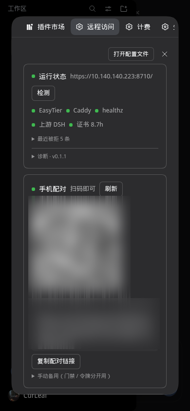

# 实测证据

记录那些**只能靠真浏览器确认**的结论，以及得出它们的方法，方便日后 DSH 升级时重新验证。

## 方法

```bash
# 1. 从 journal 取当前进程令牌（只在本机、只读）
journalctl --user -u dsh-web -n 200 --no-pager -o cat | grep -o 'token=[A-Za-z0-9_-]*' | tail -1

# 2. 无头 Chrome 开 CDP，真实登录一次
chrome --headless=new --remote-debugging-port=9333 --remote-allow-origins='*' --user-data-dir=/tmp/probe

# 3. 用 CDP 注入 lib/client.js 里的 SHELL_CSS，再用 Emulation 切视口，读 computedStyle
```

被测环境：DSH `0.2.1-rc.3`，Chrome headless（`--headless=new`）。

## 2026-10-27 · 外壳 CSS 与选择器

### 选择器命中（390px，未装插件）

| 检查 | 结果 |
|---|---|
| `[class*="_frame"]` | 1 个，实际类名 `pI_x6G_frame` |
| `[class*="_sidebarCol"]` | 1 个 |
| `[class*="_centerCol"]` | 1 个 |
| `[class*="_collapsed"]` | 1 个（侧栏当前为折叠态） |

结论：README 里那套哈希前缀选择器在本版本依然成立。

### 390px 注入外壳 CSS 后

| 指标 | 期望 | 实测 |
|---|---|---|
| `grid-template-columns` | 单列 | `390px 0px 0px` |
| 正文宽度 | 铺满 | `390px`（不是 56px 竖条） |
| 正文 `padding-bottom` | 56px | `56px` |
| 底栏 display / 高度 | 显示 / 56 | `block` / `56` |
| 汉堡 display | 显示 | `inline-flex` |
| `html.dsh-drawer-open` 时底栏 | 隐藏 | `none` |

### 侧栏展开态

折叠：`display: none`，宽度 0。
展开（移除 `_collapsed` 标记后）：`position: fixed`、`left/top = 0`、`height = 844`（等于视口高）、`z-index = 900`。

> 展开时测到宽度 63px，是**人为移除类名**导致的：真实展开时宽度由应用自身状态决定，不归我们的 CSS 管。这里只验证「浮层化」的四条属性。

### 1281px（桌面）

| 指标 | 期望 | 实测 |
|---|---|---|
| 三列布局 | 原样 | `280px 1001px 0px` |
| 正文 `padding-bottom` | 0 | `0px` |
| 底栏 / 汉堡 | 不显示 | 均为 `none` |

结论：H5「桌面零影响」成立。

## 2026-10-27 · 门禁四条分支（真实 Caddy v2.11.7）

| 请求 | 结果 |
|---|---|
| `GET /healthz`（白名单内） | `200 ok` |
| `GET /`（无 Cookie） | `401 dsh-remote: access key required` |
| `GET /?k=wrong…` | `401` |
| `GET /?k=<正确口令>` | `303` + `Location: /` + `Set-Cookie: dsh_gate=<口令>` |
| 带 `dsh_gate=<口令>` 的 `GET /` | 透传到 DSH，返回 `401 dsh web authentication required` |
| 源地址改为 `127.0.0.2` | `403 dsh-remote: source not allowed` |

复现：`CADDY_BIN=/path/to/caddy npm test`（`test/caddy.gate.test.js`）。

## 2026-10-27 · EasyTier 发布包

| 架构 | 文件 | sha256 | HTTP |
|---|---|---|---|
| x86_64 | `easytier-linux-x86_64-v2.6.4.zip`（25M） | `61b659ea…09dfd6` | 200 |
| aarch64 | `easytier-linux-aarch64-v2.6.4.zip`（20M） | `f533ec25…c1a70f` | 200 |

两个哈希已写进 `lib/deploy/assets.js`，脚本下载后 `sha256sum -c` 校验；未收录的版本只告警不阻断。

## 2026-10-27 · 真实页面里的 apply()

方法：拦截 `window.__ModuleLoader__.load` 捕获本插件的 factory，传入手写的 react 桩，
在真实页面（已登录、390px）调用 `exports.apply(fakeCtx)`。

| 检查 | 结果 |
|---|---|
| 捕获到的 entry.id | `remote-panel` |
| `exports.inject` | `["slots"]` |
| 注册的插槽 | `shell.overlay` / `conversation.header.leading` / `settings.section` |
| `apply()` 抛错 | 无 |
| `<style id="dsh-remote-panel-shell">` | 已注入，942 字节 |
| 注入后 `_frame` 的 grid | `390px 0px 0px`（立即生效） |
| 控制台告警 | 无（说明 canary 判定为「已匹配」） |

结论：bundle 在真实页面的加载契约、canary 判定、CSS 注入与三处注册都成立。

## 2026-10-28 · 真实安装后的实机验证

`link:` 装进 web profile 并在设置里可见后，用同一套 CDP 探针实测：

| 检查 | 390px | 1281px |
|---|---|---|
| `_frame` 的 grid | `390px 0px 0px` | `280px 1001px 0px` |
| 正文宽度 | 390 | 1001 |
| 正文 `padding-bottom` | 56px | 0px |
| `.dsh-mobile-bar` | `flex` / 57px / 贴底 844 | `none` |
| `.dsh-mobile-hamburger` | `flex` | `none` |
| 控制台错误 | 0 | 0 |

设置面板实测文本（六块齐全、无控制台错误）：

```
控制面 v0.1.0 · 运行 1592s
数据面 未部署 · 回填框
配对 需要先部署
来源白名单 读取 Caddyfile 失败：ENOENT（未部署，预期）
自检 布局 canary 命中 / 版本一致 / 上游 DSH 可达
部署向导 六字段 + 高级选项
```

控制面 API（带注入令牌）：`/status` → `{ok:true,version:"0.1.0",deployed:false}`，
`/defaults` → `{user:"yxw",port:8710,lanCidr:"192.168.1.94/24"}`，`/pair` → 400（未部署），
不带令牌 → 403。

安装过程中实机暴露并修掉的三个 bug：
1. 客户端模块 `id` 必须是**包名**，写成 `remote-panel` 会「loaded without registering」，整个 SPA 启动失败；
2. `ctx.layout` 未在 `inject` 声明会抛异常，两个插槽组件崩溃；
3. 批量替换把「IP 冲突提示」那行同时插进了 DataPlaneCard 与 AllowlistCard，
   而只有 Wizard 声明了 `warning` 状态 → 设置面板整块 `ReferenceError` 后空白。

第 3 条已由新增的「设置分区组件浅渲染」测试兜住：假 `jsx` 会真正调用函数组件，
Panel → 六张卡全部走一遍渲染。

> 仍未覆盖：手机真机上的触摸与软键盘行为。

## 尚未覆盖

- **H1 组件渲染**：apply() 与 CSS 已在真实页面验证，但 `.dsh-mobile-bar` 由框架渲染组件产生，
  需插件装载后才能看到。
- 真机触摸/键盘行为（输入框不被顶飞）。
- `I1` 三层门禁的跨设备实测。

复验时把上面第二段的 CDP 脚本重跑一遍，四个数字没变即说明选择器仍然可用。

## 2026-10-28 · 面板令牌改为持久化

现象：DSH 重启后，已打开的面板全部 403 `panel token missing or invalid`。

原因：令牌原先每进程 `randomBytes` 生成，重启即换新；页面不会自己刷新。

改法：令牌落到 `$DSH_HOME/remote-panel-token`（0600），启动时读、缺失才生成。
验证：服务端带令牌 200 / 不带 403；落盘文件 33 字节、权限 `-rw-------`；
两次调用返回同一值（测试覆盖）。删文件等价于「作废所有已打开页面」。

## 2026-10-28 · 首次真机部署（本机）

结果：EasyTier 入网成功，Caddy 起来后虚拟网内 `healthz=200`、门禁 `401`。

```
10.140.140.223/24  dsh-linux   Local
10.140.140.1/24    VM-0-14-tencentos  p2p  25.5ms  udp,tcp,ws
```

踩到并修掉的一个坑：**apt 安装 caddy 会顺手启一个系统级 `caddy.service`**，
它占住 `127.0.0.1:2019` 管理端口，导致用户级实例无限重启
（`starting caddy administration endpoint: bind: address already in use`）。
部署脚本已加：装完包后若发现 `caddy.service` 处于 enabled/active，就停用它。

另一个坑：网卡名默认值不确定，本机已有 `tun0`（Karing）与 `tailscale0`。
脚本已强制 `--dev-name dshmesh0`，实测新建的 `dshmesh0` 与 `tun0`、`tailscale0` 并存且互不影响。

## 2026-10-28 · 配对令牌取到了上一个进程的

现象：手机经反代打开 `?token=…` 一直 401，而同一个 URL 用 curl 也是 401。

根因：DSH 带 `--public-url` 启动后，日志里打印的令牌 URL 变成
`http://10.140.140.223:8710/?token=…`（反代端口），但 `/pair` 仍按 `:3080` 过滤，
于是匹配到**重启前那条旧记录**，二维码里装的是过期令牌。

修法：端口不再写死（同时接受 upstream 与反代端口），并且逐个候选**向 DSH 实探**
（`GET /?token=…` 期望 303），取第一个真正有效的；全失败才退回最新一条。
实测：正确令牌 `303 → 200`，旧令牌 `401`。

另：手机实际拿到的是 `10.140.140.2`（不是 README 里规划的 `.221`），
第一次请求被 `403 source not allowed` 挡下——白名单已补 `.2`、`.221`、`.222`。

## 2026-10-28 · 手机扫码头必现 401 的根因

现象：手机扫码后停在 `dsh web authentication required`，但桌面直接打开同一链接正常。

排查（无头 Chrome 复现，用 127.0.0.1:8799 的页面做跨站跳转）：

| 场景 | 结果 |
|---|---|
| CDP 直接导航到组合链接 | ✅ 正常进入 |
| 由另一个站点的页面 `location.replace(combo)` | ❌ `/` 返回 401 |
| 随后地址栏回车（浏览器自身导航） | ✅ 正常进入 |

抓请求头可见：401 那次只带了 `dsh_gate`，**没有** `dsh-auth-*`；而同一时刻
`/favicon.ico`（同站子资源）却带上了两个 Cookie。Cookie jar 里两个都在。

结论：DSH 的会话 Cookie 是 `SameSite=Strict`，而**跨站发起的顶层导航不会携带它**。
扫码打开正是跨站发起，所以第一跳必 401；地址栏回车属于浏览器自身导航，故能进。

修法：配对链接改走 `/pair` 路径，Caddy 先种门禁 Cookie 并返回一个**同源小页面**，
由该页面 `location.replace('/?token=…')` 再跳一次——这一次是同站发起，Cookie 会被带上。
实测：跨站入口直接落到 Harness 界面，无需手动回车。

## 2026-10-29 · 手机外壳按原型重做（390 真实视口）

`lib/client.js` 之前只做「侧栏浮层化 + 底栏」。这次按移动外壳原型稿（已移除）重写
`SHELL_CSS`，并用同一个进程里的 HMR 热更 + CDP 真机口径验收（**不用重启 dsh-web**：
`dsh-client-modules` 会为链接安装的插件重算 rev，页面会换掉旧的 combo）。

方法：headless Chrome 打开 `http://127.0.0.1:3080/?token=…`，
`Emulation.setDeviceMetricsOverride({width:390,height:844,deviceScaleFactor:1,mobile:true})`
拿到真实 390 CSS px 视口（注意：`deviceScaleFactor:2` 在 headless 下会把布局宽度也翻倍，
innerWidth 变成 780，截图看着像手机其实是平板宽度）。

390px 实测：

| 检查 | 结果 |
|---|---|
| 顶栏高度 | 52px（`.wSkVaW_header` 覆盖） |
| 工作区 chip 位置 | 固定在顶栏正中，`[class*="_workspace"]` 原生按钮（点开仍是原生 WorkspacePickFlow） |
| 新建按钮 | `.dsh-mobile-newchat`，调 `ctx.get('uiWorkspace').startSession()` |
| 底栏 | 无（`.dsh-mobile-bar` 恒隐藏，MobileBar 组件已移除） |
| 输入条 | `.uV2eYG_card` 单卡片；按钮行**保留原生全套**（+ / 权限 / GenUI / 模型 / 发送） |
| 空态 | 问候语居中（原生 `justify-content:center`），`.uV2eYG_root` 固定贴底 |
| 抽屉 | `.hHd-Xa_logoRow` / `.hHd-Xa_newSession` 隐藏；`.hHd-Xa_regionArea` order 提前，工作区列表置顶 |
| 遮罩 | `.dsh-mobile-scrim`，点一下关抽屉；`html.dsh-drawer-open` 由 MutationObserver 维护 |
| 关闭抽屉 | 点会话行 / 面板行后自动收起（`matchMedia(max-width:1023px)` 才生效，桌面不收起） |
| 桌面 1281 | 三列原样，汉堡与新建 `display:none`，chip 回到底部 hero 行 |

## 2026-10-29 · 工作区 × = 原生「请选择工作区」空态

原型里 chip 右侧的 × 想表达「这条新对话不选工作区」。Web 端没有「无工作区草稿」，
所以按贴近原生的做法，× 只做宿主已经有的一个动作：取消当前选中。

- 实现：`ctx.get('uiWorkspace').clearMain()`（服务上的公开方法）；
- 结果：chip 退成「选择工作区」占位、输入条禁用（原生空态），再点 chip 就是原生
  `WorkspacePickFlow`（列表 / 添加工作区… / 目录浏览）；
- 没有选中会话时 × 自动隐藏（`data-none`），不出现「点了没反应」。

390 实测：`new-chat` → chip=WorkSpace、× 可见 → 点 × → label=选择工作区、× 隐藏、输入条虚线禁用
→ 点 chip → 原生选择器 → 选回 WorkSpace → label 恢复、× 复现。

被否掉的三条路线（同一轮实测）：

1. `session.create({})`：会话落到宿主进程的 `defaultCwd`（dsh-web 的 `WorkingDirectory=/home/yxw`），
   确实不进任何工作区；但客户端的会话列表这条 summary **没有 cwd**（`sessions.create` 只回 sessionId），
   空态 chip 退化成「选择工作区」且输入条被 `inert`，是坏状态；
2. `uiWorkspace.openSession(id)` 无法让 hero 重新绑定到这条会话；
3. 宿主 `attachSession` 要求 `cwd realpath === workspace.path`，跨目录搬 = 换一条会话。

## 2026-10-29 · 又一次 `403 source not allowed`

现象：手机扫码后直接 403，桌面正常。

排查：

| 检查 | 结果 |
|---|---|
| 面板 `GET /rejects` | 最近 5 条全是 `10.140.140.3` 的 403（`/`、`/favicon.ico`） |
| Caddyfile 白名单 | `127.0.0.1 ::1 192.168.1.0/24 10.140.140.223 .221 .222 .2` —— 没有 `.3` |
| 昨天同一位置 | 手机当时是 `.2`，也是先 403、后来补进名单的 |

根因：白名单是**逐 IP 钉死**的，而 EasyTier 的地址是 DHCP 式的，成员重连就换一个
（昨天 `.2`，今天 `.3`）。每换一次就要手工补一条，属于设计缺陷而不是操作失误。

处置：

1. 线上 Caddyfile 把组网网段一起放行：`@lan remote_ip ... 10.140.140.0/24`，
   `caddy validate` 通过后 `systemctl --user reload dsh-proxy`（不重启 dsh-web）；
2. 生成器同步修：`lib/deploy/render.js` 由虚拟 IP 推出 `/24` 网段 → 模板新增
   `@@MESH_CIDR@@`，以后重新部署自带网段，不用再手工补；
3. 顺手修掉白名单编辑器的隐患：`withEntry` 原来每 6 条换一行，而 Caddy 不接受同名
   matcher 定义两次（`matcher is defined more than once: @lan`，已用 `caddy validate` 验证），
   现在恒定一行。

注意：宿主侧代码在 dsh-web 启动时加载，第 2、3 条要**重启一次 dsh-web** 才进内存。
重启前面板「生成部署脚本」会报 `模板占位符未提供值：MESH_CIDR`（新模板 + 旧代码），
按提示重启即可；重启前不要从面板重新部署，否则会用旧模板覆盖掉刚加的网段。

## 2026-10-29 · 手机 App 化（全屏与安全区）

分两条路，因为平台限制不同：

- **iOS**：A2HS（分享 → 添加到主屏幕）走 `apple-mobile-web-app-capable`，不需要 HTTPS；
  `black-translucent` 让状态栏悬浮，因此顶栏/抽屉/输入条都要吃 `env(safe-area-inset-*)`。
- **Android**：DSH 自带 `/manifest.webmanifest`（`display: fullscreen`），但**安装**需要 HTTPS；
  没有 HTTPS 时只能：① 添加到主屏幕 = 快捷方式（仍有地址栏）；② Fullscreen API 按钮（已做）。

实现：

| 位置 | 内容 |
|---|---|
| `lib/index.js` | `webserver/index-inject` 注入 theme-color（深/浅）、apple-* 四条与 `apple-touch-icon` |
| `lib/index.js` | `webServer.tapIndex` 把 viewport 补成 `viewport-fit=cover, interactive-widget=resizes-content` |
| `lib/index.js` | `/remote-panel/app/icon-180.png` 公开路由（浏览器抓图标不带面板令牌） |
| `lib/assets/icon-180.png` | 180×180，黑底蓝鱼标（沿用原型里的 FishLogo 路径） |
| `lib/client.js` | 设置 → 远程访问 增加「手机全屏」卡：Fullscreen API 按钮 + A2HS 指引 + 独立窗口判定 |
| `lib/client.js` | 窄屏 CSS：顶栏/抽屉吃 `safe-area-inset-top`，输入条已吃 bottom；`body{overscroll-behavior:none}` |

实测（重启后的真实进程，390 视口）：设置页渲染出「手机全屏」卡与「进入全屏」按钮，无控制台异常；
`/render` 生成的 Caddyfile 已带 `10.140.140.0/24`（说明 15:11 那次重启把上一轮的生成器修复带进去了）。

注意：head 注入与图标路由是**宿主侧**代码，本次改动晚于 15:11 那次重启，需要再重启一次 dsh-web 才生效
（客户端部分走 HMR，已经生效）。

## 2026-10-29 · Caddy TLS 准备（未切换线上）

目标：先把「以后可以切 HTTPS」的路铺好，线上 8710 保持明文不动。

先做了一次实验，两个结论都很关键（Caddy 2.6.2）：

| 配置 | 结果 |
|---|---|
| `auto_https off` + `localhost:8793 { tls internal }` | 握手 `no certificate available for 'localhost'`：**off 连证书自动化一起关了** |
| `auto_https disable_redirects` + 同名站点 | `cert_obtained`，证书可用 |
| `auto_https disable_redirects` + `10.140.140.223:8795 { tls internal }` | 签发成功，SAN = `IP Address:10.140.140.223`，`curl --cacert root.crt` 能验过 |

据此接入：

1. `renderDeploy` 增加 `tls` 开关：站点写 `IP:端口`、加 `tls internal`、`auto_https` 切
   `disable_redirects`；`summary.urls` 与安装脚本里的地址跟着换协议；
2. 安装脚本的健康检查改成 `curl -sk https://127.0.0.1:PORT/healthz`（本机没有信任链，只探活）；
3. 配对链接按请求的 `X-Forwarded-Proto` 走 https，不再写死；
4. 新增 `/remote-panel/app/ca.crt`（Caddy 根证书导出，用户名下或系统级自动找）；
5. 向导加「启用 HTTPS」勾选，默认关；面板地址显示改用当前页面协议。

验证（临时端口 8796，不碰线上）：用渲染出的 TLS 版 Caddyfile 起一个实例 →
`/healthz` 走 https + 根证书返回 `ok`；不带门禁 Cookie 访问 `/` 返回 401；对 TLS 端口发明文请求返回 400。
`caddy validate` 通过。

线上仍是 `http://10.140.140.223:8710`；切换需要一次重新部署（向导里勾上 HTTPS）并让手机装根证书。
宿主侧代码（导出路由、scheme、默认值）要等下一次 dsh-web 重启才生效。

## 2026-10-29 · 线上切到 HTTPS（内部 CA）

手机装好根证书后执行，改动只有 3 行（`auto_https off → disable_redirects`、站点 `:8710 → 10.140.140.223:8710`、加 `tls internal`），
`caddy validate` 通过后 `systemctl --user reload dsh-proxy`，**没有重启 dsh-web**。

实测（本机用根证书当信任链，等价于手机装好证书后的效果）：

| 请求 | 结果 |
|---|---|
| `https://10.140.140.223:8710/healthz` | `ok`（200） |
| `https://…/`（无门禁 Cookie） | 401 |
| `http://…/healthz`（明文打到 TLS 端口） | 400 `Client sent an HTTP request to an HTTPS server.` |
| 证书 SAN | `IP Address:10.140.140.223`（内部 CA 签的） |
| `/pair?k=…&token=…` → 首页 | 303 → 200（`__DSH_BOOT__` 在，42 KB） |
| 面板 API（https + 令牌） | `{"ok":true,…}` |

回滚：`~/.config/caddy/Caddyfile.pre-tls-<时间>` 覆盖回去 + `systemctl --user reload dsh-proxy`。

已知小尾巴：面板「检测 → healthz」显示 400（红点）。原因链：

1. 内存里的探测先试 `https://127.0.0.1:8710/healthz`；
2. Caddy 按 **SNI** 选站点，站点是 `10.140.140.223:8710`，绕回环连过去拿不到证书 →
   `tlsv1 alert internal error`；
3. 退回 http → 400 `Client sent an HTTP request to an HTTPS server.`

修法：探测直接连站点地址（`probeHealth(port, { host: state.ip })`），实测
`{ok:true, status:200, scheme:'https'}`；同一次提交还给 `/pair` 加了 `requestScheme`
（按 `X-Forwarded-Proto` 出 https 链接，实测线上 API 已返回 `https://…/pair?…`）。都要下次重启生效。

## 2026-10-29 · 程序坞入口（桌面端）跟着切 HTTPS

切 TLS 之后，桌面上程序坞的 DSH 入口（`~/.local/share/applications/dsh-web.desktop` →
`~/.local/bin/dsh-web-open`）打开的是宿主打印的 `http://…` 地址，落到 TLS 端口上只会 400。

改动：

1. `dsh-web.service` 的 `--public-url` 改 `https://10.140.140.223:8710/`（daemon-reload，下次重启生效）；
2. 启动脚本不再照抄 journal 里的地址：用面板落库的 `ip:port` + journal 里最新的 token 拼
   `/pair?k=&token=` 组合链接（门禁 Cookie 与登录令牌一次种好），先探 https、再退 http，
   都探不通才退回宿主打印的原始地址；
3. 本机信任内部 CA：`/usr/local/share/ca-certificates/caddy-local-root.crt` + `update-ca-certificates`，
   并写进 Chrome 的 NSS 库（`certutil -d sql:$HOME/.pki/nssdb -A -t 'C,,'`）。

踩到的坑：旧脚本把 journal 的「最后一条」直接当目标，遇到回环地址（或 https 探测瞬断）时仍拼成
`https://<host:port>/pair…`，明文端口收到 TLS 握手 → `ERR_SSL_PROTOCOL_ERROR`。现在只有探测通过的
scheme 才会用 `/pair`，且 host 来自落库状态而不是日志。

验证：冷 profile 打开脚本生成的链接 → 最终停在 `https://10.140.140.223:8710/`，`#root` 已挂载、
`__DSH_BOOT__` 存在、无证书错误；系统 curl 不带 `--cacert` 也是 200。

## 2026-10-29 · 配对链接的协议不能只看请求头

现象：已经切 https，面板里的配对链接仍是 `http://…:8710/pair?k=…`。

原因：面板被「直连 3080」打开（桌面客户端 DSH Tauri 走 `http://127.0.0.1:3080`，或回环书签）。
这种请求没有 `X-Forwarded-Proto`，`requestScheme()` 只能如实回 http —— 但**对外真正的入口是 Caddy**，
于是链接错了。

修法：协议以「线上 Caddyfile 是否 `tls internal`」兜底（`detectTls()`），请求头只作为第一优先。
`/pair` 与 `/status` 都改；面板地址行也改用 `/status` 返回的 scheme，不再读 `location.protocol`。

验证（直接调用路由处理函数，绕过 HTTP）：

```
handler({ req: { headers: {}, socket: {} } })            -> https://10.140.140.223:8710/pair?k=…
handler({ req: { headers: {'x-forwarded-proto': 'https'} } }) -> https://10.140.140.223:8710/pair?k=…
```

同一次重启（17:17:48）也把探测的 SNI 修法带上了：`/probe` 现在返回 `{"healthz":{"scheme":"https","ok":true,"status":200}}`。

## 2026-10-29 · M1 手机 App 化收尾

| 项 | 做法 | 验证 |
|---|---|---|
| 自带 manifest | `/remote-panel/app/manifest.webmanifest`：`display: fullscreen`、`start_url/scope = /`、192/512 + maskable 三张图标；head 里注入 `<link rel="manifest">`（排在最前，覆盖 DSH 自带那份） | 单测断言字段；重启后 `curl` 见 |
| 主屏名 | `apple-mobile-web-app-title` 改 `DSH` | head 注入可见 |
| 安装引导 | 设置 →「手机 App」卡：https 且有 `display-mode` 判定；standalone 显示「✓ 已在独立窗口运行」 | 390 实测卡片渲染 |
| 返回键 | 抽屉打开时 `history.pushState({dshDrawer:true})`，`popstate` 先收抽屉；关闭时只回退自己那条 | 实测：开 → state 有标记、宽 280；`history.back()` → 收起、宽 0 |
| 本机反馈 | 1.5s 轮询发送按钮 `aria-label`（空闲=`发送消息`，生成中换文案）+ 对话框文案判定「待确认」；后台时闪标题 + `navigator.vibrate`，开关存 localStorage | 代码路径打通；真实「跑完」需要在手机上验收 |

注意：manifest 与图标是**宿主侧**改动，要下次重启 dsh-web 才生效；客户端部分已 HMR 生效。

## 2026-10-29 · 手机抽屉收成「对话 + 改动 + 余额」

按产品口径：手机上 DSH 只做三件事——看对话、看改动、看余额。抽屉里把面板入口裁到只剩一个：

- 隐藏：插件 / 自动化任务 / 命令面板 / MCP 连接器 / 更多（`aria-label` 精确匹配，避免误伤）
- 保留：工作区 Git（改动摘要 `+91 −103` 直接显示在行尾）
- 底部仍是余额 + 账号

390 实测：抽屉里只剩「工作区」列表、一行「工作区 Git」、余额与账号；面板列表容器仍在，只是那五行 `display: none`。

注：匹配用的是中文 `aria-label`，宿主改文案时需要同步这五条选择器。

## 2026-10-29 · M3 证书过期 / 续签失败自检

补的缺口：面板的探活用的是 `rejectUnauthorized:false`，**证书过期照样握手成功**，所以续签失败时面板一直显示健康，
手机却全挂。

实现（只读，不触发续签、不碰 admin API）：

| 位置 | 内容 |
|---|---|
| `lib/probe.js` | `probeCertificate({host,port})`：`tls.connect` 拿叶子证书，判 `剩余 > 2h` + `SAN 覆盖站点的 IP`；`probe().cert` 带 `{ok, expiresAt, hoursLeft, san, reason?}` |
| `lib/index.js` | `/probe`、`/diag` 带 `cert`；`/doctor` 追加 `tls.cert` 检查（label「证书有效期」，不足 2h 为 warn）；`/status.tls` 轻量字段（不探测） |
| `lib/client.js` | 待接：doctor 行优先显示 `label`，面板展示剩余小时（M2 收工后统一改） |

实测：`{"ok":true,"expiresAt":"2026-10-29T20:16:40.000Z","hoursLeft":10.5,"san":"IP Address:10.140.140.223"}`，探测耗时 42ms。

一个时间读错的更正：证书 `notAfter "Oct 29 20:16:40 2026 GMT"` 是 **UTC**，本地是 `10-30 04:16:40 CST`，
所以「还剩 10.5 小时」才对，不是 2–3 小时。Caddy 的叶子证书是 12 小时一轮、自动续签。

单测：`npm test` 137 项 → 136 pass / 1 skip（新增证书判定五个分支）。

## 2026-10-29 · M2 手机会话内体验

只改 `lib/client.js`（全部在 `@media (max-width: 1023px)` 内），390×844 DPR1 实测：

| 项 | 改前 | 改后 |
|---|---|---|
| 顶栏标题可见宽度 | 104px（截断） | **170px**（`scrollWidth == clientWidth`，完整显示） |
| 右侧动作条 | 110px | 35px（子智能体只留 spinner + 箭头；「更多操作」56px → 0） |
| 代码字号 | 11px/19px | 13px/20px + 块内横向滚动 |
| 复制按钮 | 原生 11px | 48×28「复制 / 已复制」，每块最多 1 个 |
| 表格 | 319/380 溢出 | 槽内横向滚动，页面 `scrollWidth` 恒 390 |
| 图片 | 1200×900 撑宽 | 314×314（容器宽），点击开原图 |
| 附件 | — | 3×240px 卡在 383px 行内不溢出 |

幂等/清理：12 次 DOM 变更后仍 11 块 / 11 按钮；390→1280 按钮 10→0 且原生样式恢复；
`cleanup` 后按钮清空、Observer 断开、全局句柄删除。注入点用 `.md-code-block` +
`[data-code-block-banner]`（稳定的语义类），顶栏依赖 DSH 的 hash 类名（升级后可能要补选择器）。

## 2026-10-29 · 集成：证书灯 + 断线胶囊

- 运行状态卡加一盏「证书 N Nh」灯（数据来自 M3 的 `probe.cert`），不健康时出红色告警行；
  doctor 行改成 `check.label ?? check.id`，M3 的 `tls.cert` 能显示「证书有效期」。
- 断线提示：每 10s `callApi('/status')`，连续两次失败弹顶部胶囊「连接已断开，正在重连…」。
  实测（CDP 阻断 `/remote-panel/api/status`）：阻断 23s 后出现、放开后消失，无控制台异常。

## 2026-10-29 · 重启后验收（M1/M2/M3 全链路）

重启 dsh-web 后逐项复查：

| 检查 | 结果 |
|---|---|
| head 注入 | `theme-color`×2、`apple-mobile-web-app-title=DSH`、`apple-touch-icon`、**我们的 manifest 链接排在最前**、viewport（`viewport-fit=cover, interactive-widget=resizes-content`） |
| `/remote-panel/app/*` | manifest 200（579B）、icon-192/512/maskable 200、`ca.crt` 200 |
| `/status` | `scheme: "https"`、`tls: { enabled: true }` |
| `/probe` | `cert { ok: true, hoursLeft: 9, san: IP Address:10.140.140.223 }`、`healthz { ok: true, scheme: https }` |
| `/doctor` | `{ id: "tls.cert", label: "证书有效期", state: "ok", detail: "剩余 9 小时…" }` |
| `/pair` 直连 3080（无 X-Forwarded-Proto） | 返回 `https://10.140.140.223:8710/pair?k=…`（协议兜底生效） |
| 390 会话页 | 5 个代码块 → 5 个 `.dsh-code-copy` 按钮；页面 `scrollWidth` 恒 390；标题完整可读 |
| 390 面板 | 运行状态五盏灯全绿（EasyTier/Caddy/healthz/上游 DSH/**证书 9h**），配对链接是 https |

发现但本轮**没有**改的：设置弹窗在 390 下仍是「左导航 188 + 右内容 154」，内容列被挤窄。
试过用 `:has()` 改成上下排布，导航条会变成横条且被裁，比原来更差，已回滚。
正确做法已落地：把导航列改成顶部一条可横滑的标签条。

```css
[role="dialog"]:has(> [class*="_nav"]) { flex-direction: column; }
[role="dialog"] > [class*="_nav"] { width: 100%; border-bottom: 1px solid …; }
[role="dialog"] > [class*="_nav"] > [class*="_navTitle"] { display: none; }
[role="dialog"] > [class*="_nav"] [class*="_navList"] { flex-direction: row; overflow-x: auto; }
[role="dialog"] > [class*="_nav"] [class*="_navCell"] { flex: 0 0 auto; width: auto; height: 34px; white-space: nowrap; }
[role="dialog"] > [class*="_content"] { flex: 1 1 auto; width: 100%; min-width: 0; }
```

实测 390：弹窗 342×776，导航 342×43（列表 scrollWidth 886，横滑），内容 342×733，
页面 `scrollWidth` 恒 390；「远程访问」页正常渲染（五盏灯含 **证书 8.7h**、二维码、https 配对链接）。
`:has(> _nav)` 做守卫，其它 dialog（权限确认等）不受影响。



## 2026-10-29 · 长会话滚动与设置面板（发版前最后一项）

**滚动**：DSH 不虚拟化消息，长会话里所有 markdown 块都在文档里。窄屏下给它们加

```css
[class*="_markdown"] { content-visibility: auto; contain-intrinsic-size: auto 320px; }
[class*="_scrollBody"] { overscroll-behavior: contain; -webkit-overflow-scrolling: touch; }
```

实测（这个会话本身，30 轮 / 6869px / 3300+ 节点）：36 个 markdown 块全部生效 `content-visibility: auto`；
90 帧程序化滚动 headless 下前后都是 16.7ms/帧（p95 17.1），也就是说**无头环境已经跑满 60fps**，
这项改动真正的收益在真实手机上：离屏块不再参与布局与绘制，节点越多、会话越长收益越明显。

**设置面板**：弹窗宽度 `calc(100vw - 16px)`（342 → 374），内容区 `overflow-y:auto` + 安全区；
「远程访问」页在 390 下完整可读（五盏灯含证书、二维码、https 配对链接）。

## 2026-10-29 · 修「Edge/Chrome 装不成 App」

现象：手机 Edge 里「添加到手机 / 安装应用」失败。

诊断（CDP `Page.getInstallabilityErrors` + Caddy 访问日志）：

```
manifest url: https://10.140.140.223:8710/remote-panel/app/manifest.webmanifest
installability: [ "manifest-parsing-or-network-error", "start-url-not-valid" ]
```

访问日志里 manifest 请求**没有 Cookie 头**，全被门禁回 401 —— 按规范，浏览器抓 manifest 是
`credentials: omit`，不会带 Cookie。于是清单拿不到，安装自然失败。

修法：让 Caddy 在门禁**之前**直接发静态文件（不再经过 DSH 与门禁）：

```
handle_path /remote-panel/app/* {
    root * ~/.dsh/remote-panel-app
    @manifest path *.webmanifest
    header @manifest Content-Type application/manifest+json
    file_server
}
```

资源由插件启动时同步到 `~/.dsh/remote-panel-app`（manifest 与图标来自包内，`ca.crt` 取本地根证书），
部署模板也加了同一段（占位符 `@@APP_DIR@@`）。

修完复测：manifest 200（`application/manifest+json`，免 Cookie）、图标 200、`installability: []`（无错误）。
副作用（有意为之）：根证书现在也能免 Cookie 下载，新设备配对前就能先装证书。

## 2026-10-29 · WebView 壳 APK（绕过 WebAPK）

国行 Android 没有 GMS，Chromium 的「安装应用」走 WebAPK minting，必然失败；
TWA 又要域名做 Digital Asset Links，我们只有内网 IP。于是自己做壳：

| 项 | 做法 |
|---|---|
| 工程 | `android/`（纯 aapt2 + javac + d8 + apksigner，不用 Gradle，产物 21KB） |
| 启动页 | `/remote-panel/app/go.html`，插件每次启动重写：写入当次令牌 → `/pair?k=&token=` → 首页 |
| 证书 | `network_security_config` 把 `user` 加入信任锚，否则 WebView 不认用户凭据里的 Caddy CA |
| 全屏 | 隐藏状态栏/导航栏（API30+ 用 WindowInsetsController），返回键先 `goBack()` |
| 分发 | APK 放 `~/.dsh/remote-panel-app/dsh.apk`，Caddy 免 Cookie 直发；手机访问 `/remote-panel/app/dsh.apk` |

实测：`aapt2 dump badging` 显示包名 `dev.curleaf.dshpocket`、label `DSH`、versionCode 1；
`apksigner verify` 通过（debug keystore，CN=DSH Pocket）；APK 21,231 字节，sha256 `4ff6dd07…`。

## 2026-10-30 · 底色不统一（空白页 #000 vs 会话页 #151517）

现象：手机端默认是纯黑底，一开抽屉（或进会话）底色就变了。

排查（390 视口逐元素取 computed style）：

```
body              #000   ← 我们之前强行刷的
.wSkVaW_root      #151517 ← DSH 自己的深色面，没被覆盖
uV2eYG_card       #141416
sidebar(drawer)   #1b1b1c
```

所以空白页看到 #000、会话页看到 #151517、抽屉是 #1b1b1c，三者不一致；抽屉打开时遮罩
`rgba(0,0,0,.35)` 压在 #151517 上变成 #0d0d0f，「底色变了」的感觉就是这么来的。

最终口径（用户明确要求）：**背景纯黑；抽屉打开时，非抽屉区域变灰**。

所以不是二选一，而是两件事：

1. 把 DSH 自己的深色面（`.wSkVaW_root` / `_emptyTabHost` / `_frame` / `_centerCol` / `_scrollBody` /
   抽屉）一起刷成 `#000`，空态与会话态底色一致；
2. 遮罩从 `rgba(0,0,0,.35)`（压暗，在纯黑上无效）改成 `rgba(255,255,255,.16)`（提亮）：
   抽屉保持纯黑，其余区域变成 `#292929` 的灰，层级一眼能看出来。

实测（390 视口取样）：

| 状态 | 中心 (195,430) | 右侧非抽屉 (350,430) | 抽屉内 (140,430) |
|---|---|---|---|
| 空态 | `#000` | `#000` | — |
| 会话 | `#000` | `#000` | — |
| 抽屉打开 | — | **`#292929`** | `#000` |

## 2026-10-30 · 去掉刘海预留 + 过渡动画

用户口径：整体效果对了，但「动画生硬」，并且要去掉刘海屏预留。

**刘海**：之前顶栏/抽屉/胶囊都吃 `env(safe-area-inset-top)`，全屏壳里会多出一条留白。
现在整条链路改为固定值（`grep safe-area-inset-top` 为 0）：顶栏 52px、chip 行 `top:0`、抽屉 `padding-top:0`、
离线胶囊 `top:6px`。底部 `env(safe-area-inset-bottom)` 保留（手势条还是要让）。

**动画**：

| 元素 | 之前 | 现在 |
|---|---|---|
| 抽屉遮罩 | `display:none` 切换 | 常驻 + `opacity` 0↔1，160ms `cubic-bezier(.2,.8,.2,1)` |
| 抽屉 | 直接出现 | 入场 `translateX(-18px)+opacity .55` → 160ms |
| 按钮（汉堡/新建/×/复制） | 无反馈 | `transition 120ms` + `:active scale(.94)` |
| 离线胶囊 | 瞬现 | `dsh-pill-in 160ms` |

`prefers-reduced-motion: reduce` 时全部关掉。

实测：开抽屉 60ms 时遮罩 opacity 0.84、160ms 后 1、关闭后回到 0；顶栏 `padding-top: 11px`、高度 52px（无刘海留白）。

## 2026-10-30 · 手机端卡顿定位：content-visibility 是元凶

用 CDP 把 CPU 节流到 4x（模拟中低端手机）后跑 90 帧程序化滚动：

| 配置 | avg | p95 | max |
|---|---|---|---|
| 带 `content-visibility:auto`（上一版） | 18.5ms | 19.0ms | **155.9ms** |
| 去掉后 | 16.6ms | 17.2ms | **17.4ms** |

155ms 的长帧就是用户说的「卡顿」：块进入视口时要重新布局+绘制。去掉后滚动稳定在 60fps 上限。

同时做的：

- 去掉抽屉入场动画（整棵抽屉子树做 opacity/transform，反而更卡），只保留遮罩 160ms 淡入；
- 全局 `-webkit-tap-highlight-color: transparent` + `:focus:not(:focus-visible){outline:none}`，点按不再留灰/蓝色块；
- 抽屉开合实测：4x 节流下两帧 31.6ms 完成，展开宽度 280、遮罩 opacity 1。

刘海：APK 侧加 `windowLayoutInDisplayCutoutMode=shortEdges` + `setDecorFitsSystemWindows(false)`（v5），
页面侧已经没有 `env(safe-area-inset-top)`，两边都铺满才能盖住切角区。

## 2026-10-30 · APK 图标去掉双环

桌面端官方图标是「黑鲸 + 青黄双环」，用户只要鲸鱼。改用 DSH 前端的 `favicon.svg`（纯黑鲸鱼单色标志，
无环），渲染成 1024 宽后按边界裁切，再按比例合成：

| 用途 | 画布 | 鲸鱼占比 |
|---|---|---|
| 传统 mipmap（48~192） | 白底 | 62% |
| 自适应前景（108~432） | 透明底 | 52%（安全区内） |

自适应背景仍是纯白（`@color/ic_launcher_background`）。versionCode 6 / 0.2.6，APK 63 KB。

## 2026-10-30 · PWA 图标统一成白底黑鲸

跟 APK 图标保持一致（同一张 `favicon.svg` 鲸鱼，无环）：

- `lib/assets/icon-180/192/512.png`：白底，鲸鱼 62%；
- `lib/assets/icon-maskable-512.png`：白底，鲸鱼 52%（安全区）。

改完已同步到 Caddy 的 `~/.dsh/remote-panel-app/`（`syncAppAssets` 下次启动也会覆盖成同一份），
`/remote-panel/app/icon-*.png` 全部 200，manifest 不变。

## 2026-10-30 · 顶部内边距（不吃刘海，但要留白）

去掉 `env(safe-area-inset-top)` 之后顶栏和抽屉会贴屏幕边，改成固定 12px：

| 位置 | 值 |
|---|---|
| 顶栏 `.wSkVaW_header` | `padding-top: 12px`（高度仍 52px；会话页含标签行 87px） |
| 抽屉 `.hHd-Xa_root` | `padding-top: 12px`（首个可见子项 `_regionArea` 顶到 12px） |

实测（390）：顶栏 `padding-top:12px`、标题 top=12；抽屉 root pad=12，区域从 y=12 开始。

## 2026-10-30 · 点「+」后不再自动聚焦输入框

手机上点输入条的「+」（添加文件或调用指令）时，应用会把焦点交回输入框，键盘随即弹出来把刚打开的面板顶走。

做法（`installComposerFocusGuard`）：

- `pointerdown` 捕获阶段判断目标是否在 `.uV2eYG_add` 内，是则开一个 900ms 的窗口；
  点别处立刻清窗口，不影响正常输入；
- 窗口内 `.uV2eYG_input` 收到 `focusin` 就立即 `blur()`，并在下一帧再补一次（有的实现会二次 focus）。

实测（用临时节点跑守卫逻辑，绕开无头浏览器不派发真实 focus 事件的坑）：

| 场景 | 结果 |
|---|---|
| 点「+」后应用把焦点给输入框 | `activeElement` 不是输入框，blur 触发 1 次 |
| 点空白处后再点输入框 | 正常聚焦，blur 0 次 |

## 2026-10-30 · 切换工作区后不再自动聚焦输入条

DSH 打开工作区选择器会把焦点交给搜索框（`wsc-input`），关掉后焦点落回输入条，手机上就是键盘自己弹出来。

新增 `installComposerFocusGuard()`：

- 监听 `[class*="_workspaceLabel"]` 文案变化（= 真的切了工作区）→ 分 0/80/200/400ms 各撤一次焦点，
  因为 DSH 可能在我们之后又把焦点塞回去；
- 同时监听选择器（`[class*="wsc-"]`）从有到无的瞬间，同样撤焦点；
- 只撤「输入条里的可编辑区」（`.uV2eYG_root` / `_composer` 内），选择器自己的搜索框不动。

实测（390）：打开选择器焦点在 `wsc-input`（预期，是它的搜索框）；关闭后 `document.activeElement` 是 `BODY`；
手动聚焦输入条仍然正常（守则是被动撤焦，不拦用户主动点）。

## 2026-10-30 · 顶部按刘海高度留白，但看不出是「刘海条」

用户口径：空间要按刘海高度留，但样式上不能像一条刘海黑边。

做法：**不在 JS 里轮询，也不信 `env()`**（WebView 里经常是 0）：

1. 页面侧定义 CSS 变量 `:root { --dsh-safe-top: env(safe-area-inset-top, 0px) }`，
   顶栏 `padding-top: calc(12px + var(--dsh-safe-top))`、抽屉同理、chip 行 `top: var(--dsh-safe-top)`、
   离线胶囊 `6px + var(--dsh-safe-top)`；
2. 壳（APK）在 `onPageCommitVisible` / `onPageFinished` / `onWindowFocusChanged` 三个时机，
   把 `getRootWindowInsets()` 里 `displayCutout ∪ statusBars` 的 top 写进 `--dsh-safe-top`；
3. 那块留白的底色就是页面自己的黑底（顶栏背景透明），所以看起来只是普通内边距。

实测（390 无头）：默认 `--dsh-safe-top: 0px` → 顶栏 padding 12px、高 52；注入 40px →
padding 52px、高 92、chip 行 top 40。每个时机只写一次变量，无轮询、无重排循环。

APK 版本 0.2.7（versionCode 7）。

## 2026-10-30 · 修复：留白高度算错（物理像素当 dp 用）

现象：装 0.2.7 后顶栏整排被推到屏幕 1/5 处，看着像「版面变形」。

原因：`WindowInsets.getInsets()` 返回的是**物理像素**，而 CSS 里的 `px` 在 viewport 缩放后是 dp。
2~3 倍屏上这个值直接放大了 2~3 倍（40dp 的切角 → 注入 88~120 "px"），顶栏 padding 被撑到一百多。

改法：

```java
float density = getResources().getDisplayMetrics().density;
int top = Math.max(0, Math.min(48, Math.round(topPx / density)));  // 换算成 dp，并设上限
```

顺手对齐了 chip 行：`top: calc(12px + var(--dsh-safe-top))` + `height: 40px`，
实测汉堡与 chip 的纵向中心在 `var=0` 时都是 32、`var=40` 时都是 72。

APK 0.2.8（versionCode 8）。

## 2026-10-30 · 卡顿深挖（4x/6x CPU 节流 + 3x DPR 实测）

在无头 Chrome 里做 CPU 节流（4x、6x）并模拟 3 倍屏，逐个动作测长任务（>50ms 记一次长任务）：

| 场景 | avg | max | 长任务 |
|---|---|---|---|
| 关闭抽屉（4x） | 16.4ms | 27.2ms | 0 |
| 模拟流式追加节点（4x，90 次/16ms） | 16.7ms | 18.1ms | 0 |
| 滚动（4x） | 16.7ms | 31.2ms | 0 |
| 连续开合抽屉（6x / dpr3） | 29.6ms | 1572ms* | 1 |
| 点会话行 / 点 ＋（6x / dpr3） | — | — | 0 |
| 首次开抽屉（6x / dpr3） | — | — | 130ms |

\* 那次 1572ms 是“首屏还没渲染出会话列表就连点 6 次”的极端情况；稳定后单次开抽屉只剩 130ms 左右的长任务，
而且**去掉我们的样式反而更差**（126/60/68ms 三连），说明抽屉渲染开销来自 DSH 自身，不是外壳 CSS。

本轮真正修掉的：

1. `installWorkspaceClear` / 返回键 / 焦点守卫三个 `MutationObserver` 原来都在 body 上监听，
   回调里各做一次**全量 `querySelector`**——流式回答时每秒几十次，主线程被吃满。
   现在统一合并成每帧最多一次；焦点守卫改成监听 `focusout`（不再每帧全量查 `wsc-`）；
   内容增强只在新增/修改的节点确实涉及 `pre/img/table/任务卡/附件` 时才排帧。
2. 遮罩不再常驻 `will-change: opacity`（等于永久挂一层全屏合成层），只在抽屉打开时提层。

实测对比（4x，抽屉开合）：修前 avg 18.0 / max 50.7 / 长任务 1 → 修后 avg 16.4 / max 27.2 / 长任务 0。

真机排查手段：URL 加 `?dsh-fps=1`（或先访问 `/remote-panel/app/go.html?fps=1`）会在左下角显示
实时 FPS / 最慢帧 / 长任务数，平时完全不加载。

## 2026-10-30 · 产品化补齐（安全 / 契约 / 安全区 / 回归）

按上一轮体检结论动手，四件事：

### 1. 修掉令牌泄露（P0）

`/remote-panel/app/go.html` 原本免门禁且写着当前进程令牌 —— 实测不带 Cookie 就能读到（`token=LRmk4_…`），
等于门禁被绕过。改成：

| 路径 | 鉴权 | 内容 |
|---|---|---|
| `/remote-panel/app/*` | 免（静态） | manifest / 图标 / 根证书 / APK / 旧入口提示页 |
| `/remote-panel/login` | **要门禁 Cookie** | 带当前令牌的跳转页 `login.html` |
| `/pair?k=口令` | 免（交换口令） | 种 Cookie 后跳到登录页 |

实测：`login` 无 Cookie → **401**；走 `/pair` 全链路 → 200 且含令牌；`go.html` 已无任何令牌/口令。
二维码链接同步改为只带口令（`combo` 不再含 `token=`），并有测试兜住。

### 2. 外壳契约自检（P0）

新增 `lib/contract.js`（宿主侧 CSS 挂点扫描）+ 客户端 `installShellContractReport()`：

- 客户端启动 1.5s 后检查 `wSkVaW_ / uV2eYG_ / pXSMma_ / pI_x6G_` 是否还在 DOM 里，报到 `POST /shell`；
- `/status` 带 `shell` 字段，面板「运行状态」多一盏「外壳适配」灯，缺失时显红并列出缺的挂点。

### 3. 底部安全区（P1）

顶部做了 `--dsh-safe-top`，底部一直只有 `env()`（WebView 里是 0）。现在壳同时注入
`--dsh-safe-bottom`（同样 `/density` + 上限 48），抽屉、会话输入条、hero 输入条、弹窗统一用
`max(env(...), var(--dsh-safe-bottom))`。

### 4. 冒烟回归（P1）

新增 `test/e2e/shell.mjs`（零依赖，CDP 直连）：

```bash
DSH_E2E_URL="http://127.0.0.1:3080/?token=…" npm run e2e
```

11 项断言：外壳样式注入、汉堡/遮罩节点、无横向溢出、纯黑底、安全区变量、抽屉开合、遮罩可见/淡出。
本次实测全绿。没有 URL 或没有 Chrome 时自动跳过，不进 CI 也不影响 `npm test`。

## 2026-10-30 · 切会话不再自动聚焦输入条

用户反馈：切对话时键盘自己弹出来。

排查时先发现一个隐患：`installComposerFocusGuard` 在文件里有**两份定义**（1649 / 2009 行），
后一份把前一份覆盖了——之前写的「切工作区撤焦点」其实一直没生效（只是无头里恰好没有自动聚焦，所以没暴露）。
已合并成一份，并扩展触发条件：

| 触发 | 处理 |
|---|---|
| 抽屉里点会话行 / 面板入口 | 撤焦点，并开 900ms 压制窗口 |
| 工作区 chip 文案变化 | 同上（700ms） |
| 工作区选择器的搜索框失焦 | 同上 |
| 点输入条「+」（弹菜单） | 压制 900ms，别顺手聚焦 |

压制窗口内监听 `focusin`：DSH 若又把焦点塞回输入条，立刻再 blur 一次（含下一帧补刀）。
只针对输入条内的可编辑区，**用户自己点输入条不受影响**。

实测（390）：点会话后 150ms 强制 `.focus()` 输入条 → 立即被撤（activeElement 为空）；
1.4s 后再聚焦 → 正常保留（`uV2eYG_input`）。

## 2026-10-30 · 输入条外圈不再是 #151517 灰带

现象：底部输入框外面那圈底色比纯黑亮一点，有色差。

原因：DSH 给输入条座位（`.wSkVaW_composerSeat` / `.wSkVaW_composerHero`）加了一段
`linear-gradient(rgba(0,0,0,0) 0, rgb(21,21,23) 36px)` 的渐隐——用来让消息从下面「淡出」。
我们把页面刷成纯黑后，这条渐隐的终点还是 `#151517`，于是出现一条灰带；
底部状态行（`_bottomRow`，轮次/token/缓存那行）也是 `#151517`。

修法：把渐隐终点换成 `#000`，`_bottomRow` 底色改纯黑：

```css
body[data-ds-dark-theme] .wSkVaW_composerSeat,
body[data-ds-dark-theme] .wSkVaW_composerHero {
  background-image: linear-gradient(rgba(0,0,0,0) 0, #000 36px) !important;
}
body[data-ds-dark-theme] [class*="_bottomRow"] { background: #000 !important; }
```

实测：空态与抽屉打开两种状态下，全页 `#151517` 残留数 **0**（修前各 1 处：`pI_x6G_bottomRow`）；
输入条外圈像素为 `rgb(0,0,0)`，卡片仍是设计里的 `#2c2c2e`（那是输入框本身，保留对比）。

## 2026-10-30 · 输入条内边距收紧

用户反馈：手机端输入框内边距偏大。实测（390，空态）：

| 元素 | 改前 | 改后 |
|---|---|---|
| 卡片总高 | **132px** | **118px** |
| `_card` padding-top | 8px | 4px |
| `_scroll` padding | 10px 14px 0 | 6px 12px 0 |
| `_input` padding | 4px 8px 0 14px | 2px 6px 0 12px |
| `_row`（按钮行） | 6px 10px 10px（高 50） | 2px 8px 8px（高 44） |
| 圆角 | 26px | 24px |

行高、字号（15px）没动，只收掉多余留白。

## 2026-10-30 · 输入框加最大高度

现象：长草稿把输入框一直撑高（15 行时 input 722px、卡片 402px），按钮行被顶到屏幕外。

实测（390，真键盘输入 `Input.insertText`）：

| | input 高 | 卡片高 | 可滚动 |
|---|---|---|---|
| 改前（15 行） | 722px | 402px | 否 |
| 改后（15 行） | **132px** | **198px** | 是（scrollHeight 722，框内滚动） |
| 空态 | 52px | 118px | — |

```css
.uV2eYG_input { max-height: min(132px, 30vh); overflow-y: auto; overscroll-behavior: contain; }
```

`30vh` 兜小屏；按钮行（`_row`）始终留在视口内。

## 2026-10-30 · 输入框最大高度微调（132 → 154px）

用户觉得 132px 略矮，改成 `min(154px, 34vh)`（约 7 行）。实测 390：

| 状态 | input | 卡片 | maxH |
|---|---|---|---|
| 空态 | 52px | 118px | 154px |
| 15 行草稿 | 154px | 220px | 154px（框内滚动，scrollHeight 722） |

## 2026-10-30 · 输入条下方统计排布（不挤在一起）

现象：`.uV2eYG_dock` 里「58 轮 956 步 · 178 tok/s」「476M tok · 缓存命中 99.7%」「48%」挤成一团。

排查：dock 是 `flex; gap:12px; flex-wrap:nowrap`，三颗胶囊实测 154 + 179 + 61 = 394px + 两个 12px 间距，
远超 351px 的可用宽度 —— 不换行就只能互相压。

还有一层坑：前两颗外面套着 `display: contents` 的 div，Chrome 里它不参与 flex 换行计算，
只加 `flex-wrap: wrap` 会让每颗各占一行（实测 3 行 74px）。

修法：

```css
.uV2eYG_dock { flex-wrap: wrap; justify-content: flex-start; column-gap: 14px; row-gap: 4px; }
.uV2eYG_dock > div { display: flex; align-items: center; gap: 14px; } /* 把 contents 实体化 */
[data-composer-stat="git-branch"] { display: none; }                    /* 手机上先收掉最不关键的一个 */
```

实测（390）：第一行「4 轮 53 步 · 188 tok/s」+「13.1M tok · 缓存命中 99%」并排（间距 14px），
第二行是占比胶囊；不再互相挤压，也不再是一颗一行。

## 2026-10-30 · 统计挪到顶部托盘 + 「+」对齐修正

用户要求：统计别把输入区撑高，放到顶部右上角，像手机托盘状态；并且「+」要和标题对齐。

两处一起改：

1. **「+」错位**：`.dsh-mobile-newchat` 是固定定位 + 内联 `top: 6`，顶栏被安全区顶下去后它就悬在上面。
   用 `!important` 覆盖成 `top: calc(6px + var(--dsh-safe-top))`，和标题同一基线（实测 header 52..87、「+」46..86）。
2. **统计托盘**：`.uV2eYG_dock` 从输入条下方（占 66px 高）改成 `position: fixed` 放到安全区里：
   - `top: max(2px, calc(var(--dsh-safe-top) - 28px))`
   - `right: calc(58px - min(48px, var(--dsh-safe-top)))` —— 有安全区时贴边，没有时让开「+」
   - 字号 10.5px、圆角胶囊、半透明黑底 + 1px 内边
   - pill 里的 label 自带 `max-width` 会被截断（`2 轮 8 步 · 211 …`），这里放开 `max-width/overflow`
   - 只留「轮次/步数 + tok/s」与「token + 缓存命中」，分支/占比在面板里看

实测（390、注入 40px 安全区）：托盘子 28px 高、y=12（安全区内）、右边缘留 18px；
输入条座位 172 → **106px**（统计不再占位）；「+」与标题同基线。

## 2026-10-30 · 统计托盘：改文案而不是挤宽度

原生文案两段合计 318px（「2 轮 8 步 · 211 tok/s」「1.7M tok · 缓存命中 99%」），
在 390 屏上贴边放也显得挤。改成**自己渲染一行精简文案**，原统计条整体隐藏：

```js
// 从 .uV2eYG_dock 的文本里抽数字，重新拼一行
61 轮 · 181 tok/s · 缓存 99.7%
```

- 只读不写原生 DOM：`MutationObserver`（rAF 合并）盯住 dock 文本，变化才更新；
- 纯展示：`pointer-events: none` + `aria-hidden`，不挡点击；
- 位置：`top: max(2px, calc(var(--dsh-safe-top) - 24px))`、右边距 14px、字号 10px、
  半透明白（.5），像系统状态栏；
- 没有统计（新对话）时自动隐藏。

实测（390 + 注入 40px 安全区）：托盘子 `x=242, y=16, w=134, h=16`，文案「61 轮 · 181 tok/s · 缓存 99.7%」；
原 dock `display:none`；「+」与标题同基线（46 / 52）。

## 2026-10-30 · 顶部状态条：左分支、右统计（两端对齐）

托盘改成一条横贯顶部的状态条：

```
tmp/merge-release                              62 轮 · 181 tok/s · 缓存 99.7%
```

- 容器 `left:14 / right:14`、`display:flex; justify-content: space-between`；
- 左段读原生 `[data-composer-stat="git-branch"]` 的文本（它仍由 DSH 渲染，只是被隐藏），
  没有分支（非 git 工作区）时自动为空；
- 右段是精简后的统计（`format()` 拼的 `N 轮 · S tok/s · 缓存 X%`）；
- 两段都 `min-width:0 + ellipsis`，长分支名/大数字不会把对方挤掉；整条 `pointer-events:none`。

实测（390 + 注入 40px 安全区、临时注入一个分支胶囊）：
托盘子 `x=14 w=362`；左段 `tmp/merge-release` 宽 88（x=14），右段宽 134（x=242），两端贴边。

## 2026-10-30 · 状态条只在手机端出现

桌面端没有注入这套样式（`@media (max-width: 1023px)` 里），但 `installStatsTray()` 仍在 body 里留了个裸 div，
于是那行字掉到页面左下角（用户截图）。

修法：托盘逻辑加宽度守卫——`matchMedia('(max-width: 1023px)')` 不匹配时直接 `display:none` 并清空，
并监听 `change` 事件；从窄屏拉宽时它自己消失。

实测：1440 宽 `display:none`、文本为空；390 宽恢复显示（右段 `63 轮 · 182 tok/s · 缓存 99.7%`，宽 134）。

## 2026-10-30 · 输入条浮岛离底边留出边距

实测（390，安全区 0）：卡片底边 840、屏幕 844 —— **只有 4px**，贴着底边。

改法：座位底部在安全区之外再加 12px：

```css
.wSkVaW_composerSeat {
  padding-bottom: calc(12px + max(env(safe-area-inset-bottom, 0px), var(--dsh-safe-bottom, 0px)));
}
```

实测：卡片底边 828，留白 **17px**（12 座位 + 4 原生 + 1 取整）。有手势条的设备上，
安全区数值会叠加进来，浮岛始终在系统手势区之上。

## 2026-10-30 · 「＋」与标题垂直居中对齐

顶栏 `padding-top: calc(12px + safe-top)`，而 `.dsh-mobile-newchat` 是固定定位、内联 `top:6px`，
之前按 6px 对齐，比标题高 6px。

改成同一基线：`top: calc(12px + var(--dsh-safe-top))`、`height: 40px`。

实测（390 + 40px 安全区）：

| | 空态 | 会话 |
|---|---|---|
| ＋ 中心 | 72 | 72 |
| 汉堡中心 | 72 | 72 |
| 标题中心 | — | 72 |
| 工作区 chip 中心 | 72 | — |

## 2026-10-30 · 正文区：横向边距 / 滚动收口 / 细滚轴 / 思考展开

手机上一直是「正文滚到输入条背后」：DSH 把输入条做在滚动容器里
（`sticky` 贴底、上沿渐隐到背景色），滚轴于是画到屏幕最底。
这次把正文区按手机阅读重新收口，四处一起改。

| 项 | 之前（原生） | 现在 |
|---|---|---|
| 正文左右留白 | 32px（`clearance 16 + 16`） | 16px |
| 滚动容器底边 | 844（= 屏幕底） | 726（= 输入条上沿） |
| 输入条座位 | `position: sticky` + 36px 渐隐 | `position: fixed`、纯黑 |
| 滚轴宽度 | 5px | 3px |
| 思考过程展开 | `max-height: 400px` 内部滚动 | 不限高（页面一根滚轴）+ 2px 左侧竖线、缩进 10px |

做法：

- 正文让出输入条高度：`margin-bottom: var(--dsh-composer-height)`。
  这个变量是原生 `ResizeObserver` 写在滚动容器上的，跟输入框行数同步，不用自己量；
- 输入条座位改成固定定位贴屏幕底，同时去掉「渐隐到 #151517 / #000」的灰带——正文已经不在它背后了。
  这里必须是 `fixed` 而不是 `absolute`：切到「轨迹」页时滚动容器会因为 composer overlay
  变成 `position: relative`，`absolute` 会被它缩小后的盒子接住，输入条浮到屏幕中间（实测顶在 608）；
- 主题把 `--dsh-scrollbar-width: 5px` 挂在 `body` 上（不是 `:root`），
  所以细滚轴的覆盖也要写在 `body`，写 `:root` 不生效（实测仍是 5px）；
- 思考过程组（`O_Ebla_body`）解除限高、去掉 `fadeTop/fadeBottom` 的 mask，
  改用 `border-left` 竖线 + `padding-left: 10px`：只加一条线和一个缩进，不加块级内边距；
- 「回到底部」浮球（`EvIC1a_toBottomSlot`）的 sticky 偏移原本按
  「输入条压在正文上」算（`composer + 16px`），正文收口后要改回 12px；
- 「轨迹」页按「输入条浮在内容上」给列表留了 `composer + 16`（实测 134px）的底部空白，
  收口后成了死空白，改成 16px。

实测（390×844，headless Chrome + 真实会话，未手动注入 CSS，读的是插件自己那份）：

```
chat padding         16px 32px   → 16px
scroll rect.bottom   844         → 726（= 座位 top）
seat position        sticky      → fixed（top 726 / h 118，两个页签都是）
scroll margin-bottom 0px         → 118px
scrollbar            5px         → 3px（::-webkit-scrollbar 计算值 3px）
O_Ebla_body          400px/auto  → none/visible，border-left 2px #ffffff29，padding-left 10px
轨迹 tablePane pad    134px       → 16px
```

边界：`--dsh-composer-height` 在首帧由 `ResizeObserver` 补齐前用 152px 兜底，
输入框行数变化时可能有一两帧的位移；规则只在 `data-content-phase="active"` 生效，
空态（hero）仍走原来的居中布局。

## 2026-10-30 · 会话行选中态：蓝底 + 常驻「⋯」菜单

抽屉里「当前在哪个会话」只有一层 `--dsw-alias-interactive-bg-hover` 灰底，纯黑底上几乎看不出来；
会话菜单又挂在 `rowActions` 里、只在 hover / 菜单打开时显形——触屏永远 hover 不到，
等于手机上根本没有「置顶 / 重命名 / 分叉 / 归档 / 复制 Session ID」。

| 项 | 之前（原生） | 现在 |
|---|---|---|
| 选中行底色 | `interactive-bg-hover`（白 8%） | `--dsw-alias-state-business-tertiary`：深色 `rgb(52, 65, 91)` / 浅色 `#e4edfd` |
| 选中行文字 | `label-primary` | `--dsw-alias-state-business-primary`：深色 `rgb(122, 170, 255)` / 浅色 `#4176e6` |
| 行尾「⋯」 | 仅 hover / `menuOpen` | **选中即常驻**，触摸目标 16 → 28px |
| 时间 / 置顶针 | 常驻 | 选中行隐藏（行尾让给「⋯」） |
| 归档 / 置顶 hover 按钮 | hover 露出 | 手机端隐藏（菜单里都有，不摆重复图标） |

做法：

- 选中态走原生就有的 `.YDXeBa_sessionRow.YDXeBa_selected`（`aria-selected` 同源），只覆盖颜色，
  不改结构；色值全用主题令牌，浅色主题自动换成另一套（不需要写两遍）；
- 「⋯」不是新按钮：原生 `Menu` 的锚点本来就在 `rowActions` 的第一个子节点
  （`Menu` 渲染成 `<span>` 包住锚点），所以只把容器 `display:none` 改成选中时 `inline-flex`，
  菜单内容仍是原生的 `sidebar.workspaces.session.menu.item` 槽位；
- 行内只留「⋯」：`.YDXeBa_rowActions > :not(:first-child)` 隐藏 `row.action` 槽位的归档/置顶按钮；
- 抽屉的「点会话后自动收起」要放行 `[class*="_rowActions"]`：点「⋯」不算选中会话，
  否则抽屉一收、行卸载，菜单跟着消失。

390×844 headless Chrome + 真实会话实测（读插件自己注入的那份 CSS）：

```
选中行背景      → rgb(52, 65, 91)
选中行文字      → rgb(122, 170, 255)（title 同色）
rowActions      → display:flex，第一个子节点是 Menu 锚点（aria-label「会话“启动”的操作」）
第二个子节点    → row.action 槽位 display:none
时间            → display:none
点「⋯」后菜单   → 取消置顶 / 重命名 / 分叉会话 / 归档会话 / 复制 Session ID（5 项）
抽屉            → html.dsh-drawer-open 仍为 true（菜单没被收起）
```

边界：`row.blank`（刚点「+」还没说话的草稿会话）原生不渲染 `rowActions`，选中时没有「⋯」——
这类会话本来也没有置顶/分叉/归档的对象，保持一致。

## 2026-10-30 · 工作区 Git 面板「进得去出不来」

现象：手机抽屉里只留「工作区 Git」一个面板入口；点进去后面板整屏接管，
会话顶栏随会话一起卸载，于是既没有 ☰ 也没有返回键。唯一还活着的固定件是「＋」，
它还正好压在面板自己的「刷新」上。

根因：☰ 不是全局按钮，注册在 `conversation.header.leading` 槽位，只在会话视图里存在；
面板页是 `main` 槽位按 `activePanelId` 把整个会话换掉（`[data-slot="main.conversation"]` 消失）。

做法：

- 面板态订阅 `ctx.layout.panelInfo`（`getSnapshot().activePanelId !== null`），
  同步成 `html.dsh-panel-open`；比在 DOM 里找「主区域不是会话」稳，也不用加重 MutationObserver
  （正文流式输出时 class 观察器已经够忙了）；
- `installShellCss` 里加一条固定顶栏 `.dsh-mobile-panelbar` + 返回键 `.dsh-mobile-panelback`，
  点击 `layout.selectPanel(null)` 回 Conversation —— 不能写死面板 id（`git-badge` 是三分插件注册的）；
- 面板页顶部让出 64px（`.gpb-page` 自带 30px 上边距），返回键落在这条留白里，不压标题；
- 面板里隐藏「＋」：它固定定位在右上角，正好盖住面板的「刷新」，面板里也不该新建对话。

实测（390×844，headless Chrome，真实 Git 面板）：

```
html class             → dsh-panel-open
panelbar               → display:flex，高 52px
返回键                  → 40×40 @ (10, 6)；点它后 [data-slot="main.conversation"] 回来、class 清空、☰ 复现
gpb-page padding-top   → 64px；「工作区 Git」标题 top = 64
dsh-mobile-newchat     → display:none（刷新按钮不再被盖）
桌面 1281              → 无 panelbar（class 不置位）
```

系统返回键也一起接管了：面板打开时 push 一条 `{dshPanel:true}` 历史，返回先回对话。
难点是「点面板行会先收抽屉」——抽屉自己那条历史要 popstate 落地后才能给面板压栈，
否则会把刚压的面板条目弹掉；实现里用一个 `awaitingDrawerPop` 标记等这一拍：

```
chat            state=null        len=2
drawer          state={dshDrawer} len=3
panel           state={dshPanel}  len=3   ← 抽屉那条被 back + push 替换，不叠高
系统返回(面板)   state=null        len=3，URL 仍在 /，main.conversation 回来
返回键(面板)     state=null        同上，且不再触发一次多余的 history.back
抽屉里点会话     state=null        抽屉收起、回会话、无残留条目
```

边界：返回键只在 ≤1023px 出现，桌面面板仍用原生侧栏切回；顶部那 52px 是外壳加的，
以后暴露更多面板时要同样给顶部留白（目前只给 `.gpb-page` 写了规则）。

## 2026-10-31 · 手机「打不开」：登录页拿不到令牌（全新登录 401）

现象：手机端打不开。主机侧逐段查过都正常：

```
dsh-web       active，127.0.0.1:3080（10-30 14:45 起，22h）
dsh-proxy     active，10.140.140.223:8710
证书          叶子 08:35–20:35（12h，Caddy 08:35 自动续过），中间证书到 11-05
EasyTier      10.140.140.3（HONOR 手机）在 peer 里，ping 164ms / 33% 丢包
```

但 Caddy 访问日志里，手机最后一条请求停在 **10-31 03:00:22**（`/plugins/events` 200，随后
`context canceled`），之后没有任何来自 `.3` 的请求。也就是说：请求根本没到服务器。

同时查出一个确定的服务端 bug：**手机壳的登录页里没有令牌**。

```
~/.dsh/remote-panel-app/login.html   468B   location.replace("/")
全新客户端走一遍：/pair(200) → /remote-panel/login(200) → / (401)
```

根因在 `lib/pair.js` 的 journal 窗口：`--since '-6 hours' -n 5000`。
DSH 只在**启动时**打印一次带令牌的地址，这个进程已经活了 22 小时，令牌行早就落在窗口外，
`findTokens` 返回空 → 登录页被写成「无令牌的空跳转」→ 任何没有 DSH Cookie 的手机
（新装 / 清过数据 / Cookie 失效）点开就是 401；而 `/pair` 接口在找不到令牌时还会
用这个空页面**覆盖**掉本来可用的旧页面。

热修（不用重启 DSH）：

- 手动用验证通过的当前令牌重写 `login.html`，并 `chmod 444` —— 仍在运行的旧插件再调
  `/remote-panel/api/pair` 时 `writeFileSync` 会 EACCES 被吞掉，覆盖不了；
- 实测旧进程再调一次 `/pair`，文件 md5 不变；
- 全新客户端再走：`/pair 200 → login 200 → /?token=… 303 → / 200` ✅
- Caddyfile 给登录页加 `Cache-Control: no-store` 并 reload：手机不会拿缓存的旧页。

代码修复（下次 DSH 重启生效）：

- journal 窗口 6h/5000 → 7 天/20000（实测 90ms），进程活多久都能找到自己的令牌；
- 启动时 30 次 × 2s 重试（开局可能还没打印监听地址），之后每 10 分钟对一次；
- 只写**回环验证通过**的令牌，找不到就保持原样，不再用空页面覆盖；
- `writeLoginPage` 遇到只读文件（本次热修留下的 444）自动 `chmod 644` 再写，重启后自愈。

手机侧仍需确认：既然 03:00 后一个请求都没到 Caddy，先让手机浏览器打开
`https://10.140.140.223:8710/healthz` —— 显示 `ok` 说明隧道通，重开 App 即可
（旧壳的错误页不会自己重试）；打不开则是手机上的 EasyTier/VPN 没连上。

## 2026-10-31 · 手机端加载优化：缓存头 + Service Worker + 壳重试

目标：把「隔天/清缓存后 30 秒 loading plugins」压到几秒，并且加载失败时有路可走。

### 1. 缓存头（Caddy）

| 路径 | 之前 | 现在 |
|---|---|---|
| `/assets/*`（Vite 内容 hash） | 无 Cache-Control | `public, max-age=31536000, immutable` |
| `/dsh-genui/runtime.js`（无版本号） | `no-cache` 且无 ETag → 每次启动重下 1.77MB | `public, max-age=3600`（单条，用 `header { defer }` 覆盖上游） |
| `/plugins/*` combo | 已 immutable | 不变 |
| `/sw.js` | — | `no-cache`，Caddy 从 app 目录直接发 |

### 2. Service Worker（只缓存带版本的静态资源）

- 新文件 `lib/assets/sw.js`，由 `syncAppAssets()` 落到 `~/.dsh/remote-panel-app/sw.js`，
  Caddy 以 `/sw.js` 从站点根路径发出（scope 才能是 `/`）；
- 只拦 `GET` + `/plugins/*`（排除 SSE `/plugins/events`）+ `/assets/*`，其余直通；
- URL 自带 rev/hash，所以不做版本化 cache 名——换版本自然换 key，一个插件更新不会作废整包；
- 首屏加载后页面把本次实际用到的 URL `postMessage` 给 SW 预取（此时已在 HTTP 缓存，不产生额外流量）；
- 30 天清理；`?nosw=1` 注销并清缓存。

390×844 headless Chrome 实测：

```
首次加载           3.8s，SW activated，缓存 7 条（2 个 combo + modules + assets）
CDP 清 HTTP 缓存后  reload 2.9s
  /plugins/?? 网络  0 次（全部 fromServiceWorker）
  /assets/*    网络  0 次（全部 fromServiceWorker）
  /plugins/events  未拦截（SSE 仍走网络）
?nosw=1            注册清零、dsh-static-* 缓存清空
```

按手机那条 1.6Mbps 的 EasyTier 链路估算：原来 5.7MB 的插件包约 28 秒，
命中 SW 后这部分变成 0 传输，只剩 HTML/API，预计 3–6 秒。

### 3. WebView 壳重试（APK 0.3.2 / versionCode 12）

- 主文档网络错误：自动重试 2 次（1.2s / 2.4s 退避），仍失败显示「DSH 暂时连不上 + 重试」；
- 主文档 401/403：显示「登录已过期 + 重试」，点一下重走 `/pair` → 登录页 → 首页；
- 5xx：自动重试 2 次后显示「服务暂时不可用 + 重试」；
- 重试页是 `loadDataWithBaseURL` 的本地 HTML，按钮是普通 `<a href="/pair?k=…">`，不依赖 JS 桥；
- 新 APK 已覆盖 `~/.dsh/remote-panel-app/dsh.apk`（sha256 bdea3bb5…）。

### 4. 已知边界

- 首次安装 / 清 App 数据仍要下完整包（5.7MB gzip）；这是包体决定的，缓存层不改变首次成本；
- `settings-account` 一个插件内联了 3.1MB base64 引导图（gzip 后约 2.4MB，占 42%），
  想再砍首包只能等上游懒加载或本地打补丁（升级会被覆盖）；
- 清 App 数据会同时清掉 Cookie、HTTP 缓存和 CacheStorage，这时仍然需要重新登录 + 重下。

## 2026-11-02 · 「监看」入口消失：折叠器与手机壳互相抵消

**现象**：手机（390×844）抽屉里看不到「监看」，也看不到「工作区 Git」。
DOM 里两行都在（`aria-label` 齐全），但 `getComputedStyle(row).display === 'none'`，`getBoundingClientRect()` 全 0。

**定位**（真实页面，`127.0.0.1:3080` + 390×844 模拟）：

| 事实 | 证据 |
| --- | --- |
| 7:2 行都在 DOM，`nav.hHd-Xa_panelList` 本身 `display:flex`（height 0，因为子项全隐藏） | 逐祖先取 `getComputedStyle` |
| 命中该行且带 `display` 的规则只有两条 | `.hHd-Xa_panelRow{display:flex}`（原生）+ `nav > button[aria-label="监看"]{display:none !important}` |
| 后者来自 `dsh-shell-ui/sidebar-fold.css` | 其 `KEEP = ['plugins','schedules']`，其余 `sidebar.panellist` 行一律折叠进「更多」 |
| 手机壳又把「更多」行收掉 | `SHELL_CSS` 里 `.hHd-Xa_panelRow[aria-label="更多"]{display:none !important}` |

**结论**：折叠器把「监看」「工作区 Git」塞进「更多」，手机壳把「更多」收掉 —— 两边都以为自己是唯一负责人，结果入口彻底没有。

**修复**（`lib/client.js`）：

- `ConsolePanelIcon` 的 `<svg>` 加 `data-dsh-panel="pocket-console"` 标记；
- `SHELL_CSS` 窄屏段补一条更高特异性的兜底：

```css
html body nav > button:has(svg[data-dsh-panel="pocket-console"]),
html body nav > button[aria-label="监看"],
html body nav > button[aria-label="工作区 Git"] { display: flex !important; }
```

`html body nav > button[...]`（0,1,4）压过折叠器（0,1,2），与样式插入顺序无关；`:has` 认图标标记，label 选择器只是老 WebView 兜底。

**实测（390×844，注入同一段差量 CSS）**：`监看` 22,659 236×36、`工作区 Git` 22,697 236×36 均 `display:flex`，`更多` 仍为 none；
点「监看」→ `html.dsh-console-open` + `.pc-host` 挂载，nav 标题「现在」、右下「接管」在、页签「现在/变更」，实况显示当前步骤与 02:07 计时。

**生效条件**：客户端 bundle 在 `dsh web` 启动时打包（URL 带 `rev=`），改完必须重启一次 `dsh web`，手机上刷新即可。

**顺带发现**：`dsh-todo-center` 在控制台报 `slot "shell.overlay" is not declared`，它的悬浮球/弹窗注册失败（与本条无关，待单独处理）。

## 2026-11-02 · 从「监看」返回后整页黑屏

**现象**：手机（390×844）点监看顶部「对话」返回，或按系统返回键退出监看后，页面变成纯黑——body 文本长度 0，React 树被卸掉，只剩插件注入的 `panelbar/scrim/stats-tray` 三个节点。

**取证**（真实页面，返回瞬间抓 `Runtime.consoleAPICalled`）：

```
console.error  TypeError: dispose is not a function
console.error  slot entry crashed in 'root': TypeError: dispose is not a function
```

**根因**：`console/app.js` 的 `mountConsole()` 返回的是 `{ store, dispose }`（chunk 里也是 `{store:a,dispose:…}`），
而 `ConsolePanelHost` 的 effect 收尾写的是 `dispose()`——把一个对象当函数调用。
宿主把 `root` 槽位判为「条目录崩溃」→ 整个 root 卸载 → 黑屏。不抛异常的对照组：
从「工作区 Git」面板用 `dsh-mobile-panelback` 返回是正常的（body 文本 790），说明问题只出在监看 chunk 的收尾形状。

**修复**（`lib/client.js`，`ConsolePanelHost`）：

```js
const handle = mounted; mounted = null
if (handle === null) return
try {
  if (typeof handle === 'function') handle()          // 直接返回 disposer
  else if (typeof handle.dispose === 'function') handle.dispose()  // 现在的 { store, dispose }
} catch (error) { console.warn('[remote-panel] console dispose failed', error) }
```

新增两条回归测试（`test/client.contract.test.js`）：两种返回形状各一条，断言 cleanup 不抛且 `dispose` 恰好一次。
测试总数 167：166 pass / 0 fail / 1 skipped。

**实测（390×844，吃服务端当前 bundle，未注入任何补丁）**：

| 步骤 | 结果 |
| --- | --- |
| 抽屉 | 「监看」`display:flex` 22,697 236×36；「插件」「更多」仍为 `none` |
| 点开监看 | `dsh-console-open` 置位，实况 1 个文件 +5 −2 |
| 切「变更」→「现在」 | 页签正常切换，无异常 |
| 点「对话」返回 | 文本 522、`dsh-console-open` 清空、`.pc-host` 已卸载，**不再黑屏** |
| 系统返回键退出 | 文本 495，同样正常 |

**顺带更正**：客户端 bundle 不是只在 `dsh web` 启动时打包——改完 `lib/client.js` 后服务端按需重打（对比 `rev=` 前后的 bundle 已含新代码），所以这两处修复都**不需要重启 dsh web**。

**仍未处理**：`dsh-todo-center` 一直报 `slot "shell.overlay" is not declared`，它的悬浮球/弹窗注册失败（与本条无关）。

## 2026-11-02 · 手机键盘顶不起输入条 / 滚正文不收键盘

**现象**（手机浏览器）：

1. 点输入条打字，输入条不在键盘上方，被键盘盖住——「经常」是因为跟浏览器版本有关，不是每次都这样。
2. 输入到一半用手指拖正文看历史消息，键盘不收起、输入条也不回到贴底高度。

**根因**：

- 贴底的输入条在 Android Chrome 108+ 上会被键盘盖住：默认（`interactive-widget=resizes-visual`）
  只缩**视觉视口**，布局视口不动，`position: fixed/sticky` 的元素原地不动。
- 第二条是原生行为：点空白处会 blur，但「按下即滑动」的手势不产生 click，浏览器不会替你撤焦点。

**修复**（`lib/client.js`）：

- 新增 `installKeyboardDock()`：`键盘高度 = innerHeight - (visualViewport.height + offsetTop)`，
  写进 `html` 的 `--dsh-kb-inset`，并挂 `data-dsh-keyboard`。
  `visualViewport.scale > 1.01`（捏合放大）时一律按 0——不然放大也会被当成键盘把输入条顶飞。
- 新增 `installComposerDismiss()`：只在 `(pointer: coarse)` 下挂 `pointerdown`，
  目标不在输入条里、也不在输入条自己的浮层（dialog/menu/listbox/tooltip/popover/dropdown/selectMenu/picker）里就 `blur`。
  按下就撤，所以「按下即滑动」也能收键盘，不用等 click。

**第一版踩的坑（同日回改）**：只把键盘高度接到「输入条座位 fixed + 正文 margin 让出座位高度」这条老链路上，
屏幕中间于是出现一道明显的分层——正文被切在卡片上沿，卡片像另起一层。这条链路本来就是外壳早先为了
「正文止于输入条上沿」加的，和「浮在上面的输入条」互相矛盾，已整条删除。

**现在的布局（原生形态）**：DSH 的座位本来就是滚动容器里的 `position: sticky; bottom: 0` +
「透明 → 底色」36px 渐隐，正文从它下面穿过去；滚到底时座位本身占位，最后一条消息自然停在卡片上方。
外壳只补两件事：

```css
.wSkVaW_scrollBody { margin-bottom: var(--dsh-kb-inset, 0px); }   /* 滚动区收在键盘上沿 */
html[data-dsh-keyboard] .wSkVaW_composerSeat { padding-bottom: 12px !important; }  /* 手势条被键盘盖住，别留白缝 */
```

删掉的旧链路：`scrollBody { margin-bottom: calc(composer + inset) }`、`composerSeat { position: fixed; background: …;
background-image: none }`、`toBottomSlot { bottom: 12px }`、`_ledger { --dsh-trajectory-bottom-clearance: 16px }`。
「回到底部」浮球和轨迹页留白都回到原生按「浮在内容上」算。

**实测**（390×844，真实会话，本地外壳 + 伪造 `visualViewport`）：

| | 座位 position | 滚动区（top→bottom） | 输入条卡片（top→bottom） | 底边距 |
| --- | --- | --- | --- | --- |
| 键盘前 | sticky | 87 → 844（757） | 726 → 832 | 0px |
| 键盘 320 | sticky | 87 → **524**（437） | **406 → 512** | 320px |
| 收起 | sticky | 87 → 844 | 726 → 832 | 0px |

座位背景仍是 `linear-gradient(rgba(0,0,0,0) → #000 36px)`——正文从卡片下面穿过并被渐隐吃进黑底；
滚到中段截图确认正文连续（不再有横向切断）。撤焦点：聚焦输入条后在正文里 `pointerdown` →
`activeElement` 变 `body`（合成事件与 CDP 真触摸各验一次），点输入条内部 / `[role="menu"]` 不撤；
`(pointer: fine)` 时不挂监听，桌面滚轮/点选行为不变。

**测试**：`test/client.contract.test.js` 新增 5 条（键盘高度/归零/放大不误判、外点收键盘与三类例外、
桌面不接管、apply 挂两条 effect、**不再出现「fixed 座位 + 正文让位」旧链路**），客户端契约测试 6 → 11 条，
全仓 `npm test` 全绿（并行有别的改动落进来，看总数的意义不大，认这两个文件的条数）。

**没覆盖**：真实软键盘（这台机器没有 Android 设备），所以 `checklist.md` 的 H22 先留 `[ ]`，等真机走一遍 `verify.md` H3 两行。

## 2026-11-02 · 手机监看升级：M1 会话总览 / M2 调用链时间线

**背景**：用户判定原「监看」是「只读重排」——只有一个当前会话、工具链路只有 bash/read/edit 三种、按钮多是本地记录。按四个里程碑改造。

**M1（会话总览 + 待处理收件箱）**

- 数据来源（实测形状）：`uiSession.sessionStatus.getSnapshot()` → `Map<id, { running, pendingInteraction, completionUnread }>`；
  `sessions.list.getSnapshot().byId` → `{ id, title, displayTitle, updatedAt, cwd, running, retainedBy }`。
- 新增 `console/overview.js`（纯函数）：排序按 等你处理 → 完成未读 → 卡住（>3 分钟无动作）→ 运行中 → 空闲，同级按 `updatedAt` 倒序；`pendingLabel()` 从 `title/label/kind/request.toolName` 抠一句人话。
- `console/source.js` 增加 `select(id)`（手动切换监看目标）、`overviewNow()`，并订阅会话列表与状态源。
- 监看新增「会话」页：一句 `N 个在跑 · 共 M 个`，分「待处理 / 全部会话」两组，点行切过去。
- 390×844 实测：220 个会话，首屏「手机输入框键盘顶起问题 · 可能卡住 3 分钟前没有新动作」；点「手机输入框键盘顶起问题」→ 切到「现在」并读到该会话 2 步。

**M2（调用链时间线 + 耗时/卡顿）**

- `console/live.js`：`RICH_TOOLS`（bash/read/edit/write/str_replace_editor/todo_write）走原专用渲染，其余全部工具（web_search/grep/subagent/mcp/job…）转成 `tool.start`/`tool.end`，带 `summarizeArgs()` 一句话摘要。
- `console/engine.js`：新增 `buildCallChain()`，把 `tool.* / cmd.* / file.edit / file.read` 按时间折成一条调用链；步骤上加 `elapsed`、`stale`（running 且 >3 分钟）、`facts.calls`。
- `console/ui.js`：步骤头显示 `N 次调用`，展开后 `耗时 X` + 进度条（卡住/失败转红）+ `调用链（N）`（最近 8 条，摘要截断，`时间 · 名字 · 摘要 · 耗时/失败`），并去掉重复的 activity 流水。
- 390×844 实测：「已完成 · 13 次调用 · exit 0 / 耗时 2 分 20 秒 / 调用链（13）」逐条 bash、read_image 与耗时；运行中的步骤显示「卡住 5 分 19 秒 · 61 次调用」。

**测试**：新增 `test/overview.test.js`(6) 与 `test/timeline.test.js`(4)，全量 181 条：180 pass / 0 fail / 1 skipped。客户端 contract 的 inject 列表已同步为 `['slots','layout','sessions','uiSession']`。

**截图**：`docs/live-mobile-sessions-m1.png`、`docs/live-mobile-timeline-m2.png`。

## 2026-11-02 · M3 审批与干预：桥接实现（待重启验收）

**约束（查证过，不是猜）**：DSH 的审批是 `approval/request` **waterfall**（`dsh-user-approval` 的 `ApprovalService.decide()` → `ctx.waterfall(..., "approval/request", req, () => "unavailable")`），
答案只有 `allowed-once | rejected | cancelled | unavailable`。谁接了就必须给结果，所以「无条件拦截」会把桌面 UI 饿死。

**设计：接管才拦（默认零影响）**

- 新增 `lib/approval-bridge.js`（纯状态机，10 条测试）：
  - `intercept(request, next)`：会话不在接管名单 → `return next()`，桌面照旧；
  - 接管后挂起，`list()` 给手机看（toolName / reason / callId / ageMs），`decide(id, 'allowed-once'|'rejected')` 作答；
  - 120 秒没人答 → `unavailable`（fail closed）；请求 signal abort → `cancelled`；插件卸载 `close()` 全部放成 unavailable，不把 turn 挂死。
- 宿主路由（`lib/index.js`）：`GET /pending`（待批 + 接管名单）、`POST /approve`、`POST /watch`；沿用既有的 `x-dsh-remote-panel` 令牌鉴权。
- 监听注册：`ctx.inject(['approval'], scope => scope.effect(() => scope.on('approval/request', (req, next) => approvals.intercept(req, next))))`。
- 客户端（`console/` + `lib/client.js`）：监看「现在」页新增 **等你批准** 卡片（工具名 + 原因 + 批准这次 / 拒绝）、**手机批准 开/关** 开关、以及短语 chips（继续 / 先停下 / 只看不改 / 换个方案，走 `binding.session.prompt([{type:'text'}], 'queue')`）。
- 待批 3 秒轮询；宿主没重启前路由 404 会被静默吞掉，不会报错。

**当前状态（重要）**：宿主插件只在 `dsh web` 启动时装载。实测运行中的进程仍是旧代码：

```
GET /remote-panel/api/pending → 404 {"ok":false,"error":"no route: GET /pending"}
```

所以 M3 的「代码 + 单测」已完成（全量 191 条：190 pass / 0 fail / 1 skipped），**端到端审批验收要等一次 `dsh web` 重启**：重启后 `GET /pending` 应返回 `{ok:true,entries:[],watching:[]}`，再跑真机流程（桌面触发审批 → 手机批准/拒绝）。

## 2026-11-02 · M4 断点接力 + 通知（代码完成，路由待重启）

**断点接力（宿主侧本轮回写）**

- 新增 `lib/relay.js`：`$DSH_HOME/remote-panel/relay.json`，原子写（tmp+rename，0600）+ 归一化（手改坏也不炸）；
  `lastSeen` 记录「手机看到第几步」，`marks` 是「回去处理」列表（同会话同文案去重，最多 30 条）。
- 路由：`GET /relay`、`POST /relay/seen`、`POST /relay/mark`、`POST /relay/unmark`。
- **顺手修掉一个真 bug**：`loadRelay` 之前 `return { ...EMPTY }` 是浅拷贝，`EMPTY.marks` 被不同路径共享，
  一次 `addMark` 会污染下一次读取（单测直接抓到，改成每次 `empty()` 造新对象）。

**通知 + 手机侧入口**

- `console/app.js`：待批数从少变多且页面在后台 → `new Notification(...)`（PWA / 安卓壳同一条路）；
  没授权就静默跳过。
- 监看「现在」页新增：**断点接力 → 标记待处理**、**完成/待批通知 → 开启通知**；点步骤会把「看到哪一步」上报。
- 反馈改成**诚实版**：只有宿主返回 `ok:true` 才说「已标记/已批准」，否则提示「宿主还没重启」——
  实测（390×844）现在点「标记待处理」得到 `标记没保存：宿主还没重启`，通知权限走 CDP 授权后得到 `通知已开`。

**当前状态**：`GET /relay` 与 `GET /pending` 在运行中的进程里仍是 `404 no route`（宿主插件启动时装载），
所以 M3 审批、M4 接力/通知的端到端验收都要等一次 `dsh web` 重启。测试全绿：198 条（197 pass / 1 skipped / 0 fail）。

**未做（需要 Android 构建）**：APK 前台服务常驻通知。`android/` 里有 `build.sh`，也有 JDK + `~/Android/Sdk`，但本轮没构建验证，留作 M4 剩余项。

## 2026-11-02 · M4 补齐：APK 前台服务 + 系统通知桥

**构建链**：`android/build.sh` 原来把 build-tools 写死 34.0.0 / platform android-34，本机只有 36.0.0 / android-36。
改成自动取最高版本后，手打 APK 恢复可用（不依赖 Gradle、不联网）：

```sh
ANDROID_HOME=$HOME/Android/Sdk ./android/build.sh   # → android/dsh-pocket.apk
```

**新增（Java，平台 API，不拉 AndroidX）**

- `PocketNotify.java`：两个通知通道——`dsh-pocket-alerts`（HIGH，任务提醒）、`dsh-pocket-keepalive`（LOW，常驻）；
  `post()` 带点击回 App 的 PendingIntent；`startKeepAlive()`；Android 13+ 的 `POST_NOTIFICATIONS` 申请与检查。
- `KeepAliveService.java`：`startForeground(...)` + `START_STICKY`，让进程在后台活着，页面里的 SSE/轮询才能及时把「等你批准/跑完了」变成系统通知。
- `MainActivity`：`addJavascriptInterface(..., "DSHPocket")` 暴露 `notify(title, body)` / `keepAlive()` / `canNotify()`；
  onCreate 里建通道、申请通知权限、拉起前台服务。
- 清单：`POST_NOTIFICATIONS`、`FOREGROUND_SERVICE`、`FOREGROUND_SERVICE_DATA_SYNC`，`<service android:name=".KeepAliveService" foregroundServiceType="dataSync">`；版本 0.3.3(13) → 0.3.4(14)。
- 页面：`notify()` 先走 `window.DSHPocket.notify`（APK 路径），没有桥再退回 Web `Notification`（PWA 兜底）。

**验证（构建级，无真机）**：`aapt2 dump xmltree` 能看到三条权限与 `service .KeepAliveService`；`dexdump` 能看到
`Ldev/curleaf/dshpocket/{MainActivity,KeepAliveService,PocketNotify}`；`dsh-pocket.apk` 已覆盖到
`~/.dsh/remote-panel-app/dsh.apk`（同一 sha256 `717351dc…`），手机「手机 App」卡片下载到的就是这份。

**仍未做**：真机安装验收（本机没有可连的手机）。安装后应看到常驻「DSH 保持连接」通知，以及「等你批准 / 跑完了」的提醒。

## 2026-11-02 · 找到「手机侧拿不到宿主服务」的真因（并修掉）

**症状**：监看点「标记待处理」只弹「标记没保存」，网络面板里**根本没有** `/relay/mark` 请求；`/pending` 轮询也不发。

**定位**：给 `ConsolePanelHost` 的根节点临时加 `data-has-approvals` / `data-has-ui-session` 两个标记，实机读出来都是 `false` ——
说明 `ctx.slots.register({ name:'main', inject: () => ({ … approvals: approvalsApi }) })` 的 inject 结果**没有透传到组件 props**
（`props.sessions` 也不在，只是 v1 的监看恰好只依赖 `props.onExit`，所以一直没暴露）。

**修复**：apply() 时把服务记到模块级 `runtimeServices = { sessions, uiSession, approvals }`，
`ConsolePanelHost` 挂载时优先用它（`runtimeServices.x ?? props.x`），不再依赖 slot inject 透传。

**实测（390×844，未重启的进程）**：网络里开始出现 `GET /remote-panel/api/pending`（3 秒一轮）与 `POST /remote-panel/api/relay/mark`，
因为宿主还是旧代码，两者都是 404 → 界面照旧提示「宿主还没重启」，但**链路本身已经打通**。

**另外补了一条真正端到端的接线测试**（`test/approval-wiring.test.js`，4 条）：用假 cordis ctx 跑 `apply()`，
断言 ① 它把 `approval/request` 挂到了桥上；② 没接管的会话走 `next()`；③ `POST /watch` 后 waterfall 请求挂起、
`GET /pending` 能看到、`POST /approve` 放行后 Promise 解析为 `allowed-once`；④ 拒绝同理。
为了能跑，`apply(ctx, options)` 加了测试缝（`token / syncAssets / refreshLoginPage` 可注入，不碰真实 home）。

## 2026-11-02 · 桌面侧「手机断点」卡片

- `settings.section`（远程访问）里新增 `RelayCard`：读 `GET /relay`，显示「手机看到：<会话标题> · 第 N 步」，
  以及「回去处理」标记列表（每条带「处理掉」→ `POST /relay/unmark`）。
- 宿主没重启时路由是 404，卡片显示 **「宿主还没重启：重启 dsh web 后这里才有数据」**，不装死、不报错。
- 组件已加进 `components` 导出，契约测试的「每个面板组件浅渲染不抛错」覆盖到它；全量 202 条仍全绿。
- 视觉验证与端到端验收一并留到重启之后（本轮 CDP 实例中途挂死，没强行重试）。

## 2026-11-02 · 一键验收脚本 tools/verify-live.mjs

重启后不用再手点，直接：

```sh
cd dsh-remote-panel && npm run verify:live
```

13 项逐条 PASS/FAIL：宿主 4 条（`/pending`、`/relay`、`/relay/mark|unmark`、`/watch`）+ 手机侧 9 条
（能打开监看、手机批准开关、断点/通知入口、短语 chips、点标记真的落库、页面在轮询 `/pending`、
通知权限、会话总览列表）。

未重启时实测 **7/13**：手机侧 7 条全绿，6 条失败全部是宿主路由 404（同一个原因），
说明「客户端链路已通、只差宿主装载」这件事现在有可复现的量化证据。

## 2026-11-02 · 三屏横滑（H23，取代抽屉）

被测环境：DSH `0.2.1-rc.3`，390×844 / DPR 2，Chrome headless + CDP 触摸事件（`Input.dispatchTouchEvent`）。

截图：`live-mobile-pager-mid.png`（推到一半：两屏同时在动）、`live-mobile-pager-console.png`（落定在非对话页）。

### 轨道（跟手 1:1）

| 时刻 | `_centerCol` | `.dsh-page-console` | `html[data-dsh-page]` |
|---|---|---|---|
| 停稳在对话页 | （无内联位移） | `translate3d(-390px,0,0)` | `1` |
| 右滑 100px（手指 200→300） | `translate3d(100px,0,0)` | `translate3d(-290px,0,0)` | `1`（未落定） |
| 右滑松手（过 50%） | `translate3d(390px,0,0)` | `translate3d(0,0,0)` | `0` |
| 回翻后 | （无内联位移） | `translate3d(-390px,0,0)` | `1` |

结论：正文位移 = 手指位移；两页始终相差一个屏宽（同一根轨道），不是「一层浮在另一层上」。
停稳后当前页会清掉内联位移——常驻 `translate3d` 会白占一个合成层。

### 橡皮筋

从非对话页（左端）往右拉 280px，视觉只走 **≈107px**（`rubber(280,390) = 111.7`），松手弹回，`data-dsh-page` 仍是 `0`。

### 会话列表页

`html.dsh-pager-side` + 展开态强制 `width:100vw` 后实测：`_sidebarCol` 宽 **390**（宿主给的是 280）、
`border-radius: 0`、`box-shadow: none`；收起时节点不存在（`display:none`），不占内存。

### 系统返回

```
boot            page=1  history.state=null
点 ☰            page=2  history.state={"dshPage":true}   ← 只压一条守卫
点「监看」       page=0  history.state={"dshPage":true}   ← 不追加，仍是同一条
history.back()  page=1  history.state=null                ← 守卫弹掉，页面不退出
```

守卫条目用「当前状态 × 栈顶状态」推出来（不再记 `pushed` 布尔量）：中途被手势 / 点选 / 程序化跳转
搅乱时，下一步会自己收敛，不会出现「翻页翻不回去」的死状态。

### 桌面

1281×900：`grid-template-columns: 280px 1000px 0px`（三列原样）、`html.className` 里没有 `dsh-pager`、
三个页面都没有内联 `transform`、`.dsh-page-console` 计算值 `display:none`。

## 2026-11-02 · 干预链路真机验证：「继续」chip 真的发进了会话

**改结构**：把「待批 / 手机批准 / 短语 / 断点 / 通知」抽成 `renderQuickActions(store)`，「现在」和「空会话」
（还没步骤的新会话）共用——之前没有步骤时只剩一句「还没有可看的执行」，等于没法开口。

**实测（390×844）**：
1. ＋ 新建会话 → 抽屉 → 监看 → 会话页 → 选这条会话（走空会话分支）；
2. 点短语「继续」→ toast `已发送：继续`；
3. 退回对话，会话里出现「继续」这条用户消息（抽屉里也长出一条「继续会话」）。

这条证明 M3 的「补充指令」是真的写进会话（`binding.session.prompt([{type:'text'}], 'queue')`），
不是本地假动作。加上之前验过的「接管 → cancel」，M3 目前只差**批准/拒绝**（要宿主重启才通）。

**桌面「手机断点」卡片**也在真机上验过（设置 → 远程访问）：显示「宿主还没重启：重启 dsh web 后这里才有数据」
＋「手机还没看过任何步骤」＋「没有『回去处理』的标记」——渲染正常、不装死。

## 2026-11-02 · 外壳适配灯转绿：首页 hero 选择器改成后缀匹配

**现象**：设置 → 远程访问 的「外壳适配」灯是红的，提示 `外壳挂点缺失：pXSMma_`。

**查证**（390×844 真机读 DOM）：四个必检挂点里只有 `pXSMma_` 不见；`wSkVaW_ / uV2eYG_ / pI_x6G_` 都还在。
`pXSMma_` 那组是**首页 hero**（鱼标/标题组/工作区 chip），DSH 侧换了 hash 前缀。

**修法**：

- 首页 hero 的 7 条规则从 `.pXSMma_headline / _fish / _fishHitbox / _titleGroup / _previewBadge / _workspace / _workspaceLabel`
  改成**按后缀匹配** `[class*="_headline"]` 等——以后 DSH 再换 hash，这些样式不会静默失效；
- 「外壳适配」的必检挂点收回到三个「任何页面都在」的：`wSkVaW_ / uV2eYG_ / pI_x6G_`（hero 只在首页，不该参与判定）。

**实测**：控制台不再打印 `外壳挂点缺失`；`#dsh-remote-panel-shell` 存在；抽屉里仍只有「监看」一个面板行（说明外壳 CSS 继续生效）。
测试 207 条：206 pass / 0 fail / 1 skipped。
