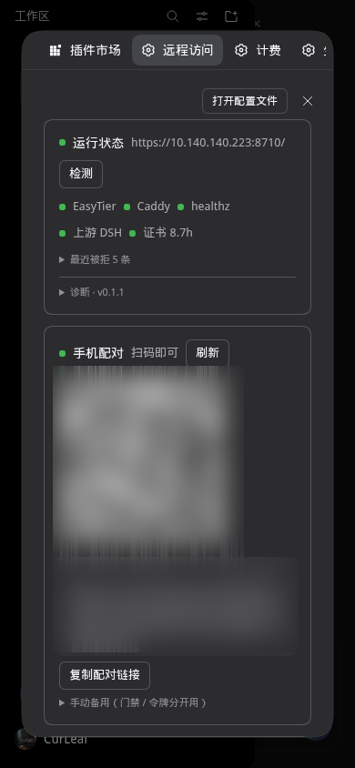

# 实测证据

记录那些**只能靠真浏览器确认**的结论，以及得出它们的方法，方便日后 DSH 升级时重新验证。

## 方法

```bash
# 1. 从 journal 取当前进程令牌（只在本机、只读）
journalctl --user -u dsh-web -n 200 --no-pager -o cat | grep -o 'token=[A-Za-z0-9_-]*' | tail -1

# 2. 无头 Chrome 开 CDP，真实登录一次
chrome --headless=new --remote-debugging-port=9333 --remote-allow-origins='*' --user-data-dir=/tmp/probe

# 3. 用 CDP 注入 lib/client.js 里的 SHELL_CSS，再用 Emulation 切视口，读 computedStyle
```

被测环境：DSH `0.2.1-rc.3`，Chrome headless（`--headless=new`）。

## 2026-10-27 · 外壳 CSS 与选择器

### 选择器命中（390px，未装插件）

| 检查 | 结果 |
|---|---|
| `[class*="_frame"]` | 1 个，实际类名 `pI_x6G_frame` |
| `[class*="_sidebarCol"]` | 1 个 |
| `[class*="_centerCol"]` | 1 个 |
| `[class*="_collapsed"]` | 1 个（侧栏当前为折叠态） |

结论：README 里那套哈希前缀选择器在本版本依然成立。

### 390px 注入外壳 CSS 后

| 指标 | 期望 | 实测 |
|---|---|---|
| `grid-template-columns` | 单列 | `390px 0px 0px` |
| 正文宽度 | 铺满 | `390px`（不是 56px 竖条） |
| 正文 `padding-bottom` | 56px | `56px` |
| 底栏 display / 高度 | 显示 / 56 | `block` / `56` |
| 汉堡 display | 显示 | `inline-flex` |
| `html.dsh-drawer-open` 时底栏 | 隐藏 | `none` |

### 侧栏展开态

折叠：`display: none`，宽度 0。
展开（移除 `_collapsed` 标记后）：`position: fixed`、`left/top = 0`、`height = 844`（等于视口高）、`z-index = 900`。

> 展开时测到宽度 63px，是**人为移除类名**导致的：真实展开时宽度由应用自身状态决定，不归我们的 CSS 管。这里只验证「浮层化」的四条属性。

### 1281px（桌面）

| 指标 | 期望 | 实测 |
|---|---|---|
| 三列布局 | 原样 | `280px 1001px 0px` |
| 正文 `padding-bottom` | 0 | `0px` |
| 底栏 / 汉堡 | 不显示 | 均为 `none` |

结论：H5「桌面零影响」成立。

## 2026-10-27 · 门禁四条分支（真实 Caddy v2.11.7）

| 请求 | 结果 |
|---|---|
| `GET /healthz`（白名单内） | `200 ok` |
| `GET /`（无 Cookie） | `401 dsh-remote: access key required` |
| `GET /?k=wrong…` | `401` |
| `GET /?k=<正确口令>` | `303` + `Location: /` + `Set-Cookie: dsh_gate=<口令>` |
| 带 `dsh_gate=<口令>` 的 `GET /` | 透传到 DSH，返回 `401 dsh web authentication required` |
| 源地址改为 `127.0.0.2` | `403 dsh-remote: source not allowed` |

复现：`CADDY_BIN=/path/to/caddy npm test`（`test/caddy.gate.test.js`）。

## 2026-10-27 · EasyTier 发布包

| 架构 | 文件 | sha256 | HTTP |
|---|---|---|---|
| x86_64 | `easytier-linux-x86_64-v2.6.4.zip`（25M） | `61b659ea…09dfd6` | 200 |
| aarch64 | `easytier-linux-aarch64-v2.6.4.zip`（20M） | `f533ec25…c1a70f` | 200 |

两个哈希已写进 `lib/deploy/assets.js`，脚本下载后 `sha256sum -c` 校验；未收录的版本只告警不阻断。

## 2026-10-27 · 真实页面里的 apply()

方法：拦截 `window.__ModuleLoader__.load` 捕获本插件的 factory，传入手写的 react 桩，
在真实页面（已登录、390px）调用 `exports.apply(fakeCtx)`。

| 检查 | 结果 |
|---|---|
| 捕获到的 entry.id | `remote-panel` |
| `exports.inject` | `["slots"]` |
| 注册的插槽 | `shell.overlay` / `conversation.header.leading` / `settings.section` |
| `apply()` 抛错 | 无 |
| `<style id="dsh-remote-panel-shell">` | 已注入，942 字节 |
| 注入后 `_frame` 的 grid | `390px 0px 0px`（立即生效） |
| 控制台告警 | 无（说明 canary 判定为「已匹配」） |

结论：bundle 在真实页面的加载契约、canary 判定、CSS 注入与三处注册都成立。

## 2026-10-28 · 真实安装后的实机验证

`link:` 装进 web profile 并在设置里可见后，用同一套 CDP 探针实测：

| 检查 | 390px | 1281px |
|---|---|---|
| `_frame` 的 grid | `390px 0px 0px` | `280px 1001px 0px` |
| 正文宽度 | 390 | 1001 |
| 正文 `padding-bottom` | 56px | 0px |
| `.dsh-mobile-bar` | `flex` / 57px / 贴底 844 | `none` |
| `.dsh-mobile-hamburger` | `flex` | `none` |
| 控制台错误 | 0 | 0 |

设置面板实测文本（六块齐全、无控制台错误）：

```
控制面 v0.1.0 · 运行 1592s
数据面 未部署 · 回填框
配对 需要先部署
来源白名单 读取 Caddyfile 失败：ENOENT（未部署，预期）
自检 布局 canary 命中 / 版本一致 / 上游 DSH 可达
部署向导 六字段 + 高级选项
```

控制面 API（带注入令牌）：`/status` → `{ok:true,version:"0.1.0",deployed:false}`，
`/defaults` → `{user:"yxw",port:8710,lanCidr:"192.168.1.94/24"}`，`/pair` → 400（未部署），
不带令牌 → 403。

安装过程中实机暴露并修掉的三个 bug：
1. 客户端模块 `id` 必须是**包名**，写成 `remote-panel` 会「loaded without registering」，整个 SPA 启动失败；
2. `ctx.layout` 未在 `inject` 声明会抛异常，两个插槽组件崩溃；
3. 批量替换把「IP 冲突提示」那行同时插进了 DataPlaneCard 与 AllowlistCard，
   而只有 Wizard 声明了 `warning` 状态 → 设置面板整块 `ReferenceError` 后空白。

第 3 条已由新增的「设置分区组件浅渲染」测试兜住：假 `jsx` 会真正调用函数组件，
Panel → 六张卡全部走一遍渲染。

> 仍未覆盖：手机真机上的触摸与软键盘行为。

## 尚未覆盖

- **H1 组件渲染**：apply() 与 CSS 已在真实页面验证，但 `.dsh-mobile-bar` 由框架渲染组件产生，
  需插件装载后才能看到。
- 真机触摸/键盘行为（输入框不被顶飞）。
- `I1` 三层门禁的跨设备实测。

复验时把上面第二段的 CDP 脚本重跑一遍，四个数字没变即说明选择器仍然可用。

## 2026-10-28 · 面板令牌改为持久化

现象：DSH 重启后，已打开的面板全部 403 `panel token missing or invalid`。

原因：令牌原先每进程 `randomBytes` 生成，重启即换新；页面不会自己刷新。

改法：令牌落到 `$DSH_HOME/remote-panel-token`（0600），启动时读、缺失才生成。
验证：服务端带令牌 200 / 不带 403；落盘文件 33 字节、权限 `-rw-------`；
两次调用返回同一值（测试覆盖）。删文件等价于「作废所有已打开页面」。

## 2026-10-28 · 首次真机部署（本机）

结果：EasyTier 入网成功，Caddy 起来后虚拟网内 `healthz=200`、门禁 `401`。

```
10.140.140.223/24  dsh-linux   Local
10.140.140.1/24    VM-0-14-tencentos  p2p  25.5ms  udp,tcp,ws
```

踩到并修掉的一个坑：**apt 安装 caddy 会顺手启一个系统级 `caddy.service`**，
它占住 `127.0.0.1:2019` 管理端口，导致用户级实例无限重启
（`starting caddy administration endpoint: bind: address already in use`）。
部署脚本已加：装完包后若发现 `caddy.service` 处于 enabled/active，就停用它。

另一个坑：网卡名默认值不确定，本机已有 `tun0`（Karing）与 `tailscale0`。
脚本已强制 `--dev-name dshmesh0`，实测新建的 `dshmesh0` 与 `tun0`、`tailscale0` 并存且互不影响。

## 2026-10-28 · 配对令牌取到了上一个进程的

现象：手机经反代打开 `?token=…` 一直 401，而同一个 URL 用 curl 也是 401。

根因：DSH 带 `--public-url` 启动后，日志里打印的令牌 URL 变成
`http://10.140.140.223:8710/?token=…`（反代端口），但 `/pair` 仍按 `:3080` 过滤，
于是匹配到**重启前那条旧记录**，二维码里装的是过期令牌。

修法：端口不再写死（同时接受 upstream 与反代端口），并且逐个候选**向 DSH 实探**
（`GET /?token=…` 期望 303），取第一个真正有效的；全失败才退回最新一条。
实测：正确令牌 `303 → 200`，旧令牌 `401`。

另：手机实际拿到的是 `10.140.140.2`（不是 README 里规划的 `.221`），
第一次请求被 `403 source not allowed` 挡下——白名单已补 `.2`、`.221`、`.222`。

## 2026-10-28 · 手机扫码头必现 401 的根因

现象：手机扫码后停在 `dsh web authentication required`，但桌面直接打开同一链接正常。

排查（无头 Chrome 复现，用 127.0.0.1:8799 的页面做跨站跳转）：

| 场景 | 结果 |
|---|---|
| CDP 直接导航到组合链接 | ✅ 正常进入 |
| 由另一个站点的页面 `location.replace(combo)` | ❌ `/` 返回 401 |
| 随后地址栏回车（浏览器自身导航） | ✅ 正常进入 |

抓请求头可见：401 那次只带了 `dsh_gate`，**没有** `dsh-auth-*`；而同一时刻
`/favicon.ico`（同站子资源）却带上了两个 Cookie。Cookie jar 里两个都在。

结论：DSH 的会话 Cookie 是 `SameSite=Strict`，而**跨站发起的顶层导航不会携带它**。
扫码打开正是跨站发起，所以第一跳必 401；地址栏回车属于浏览器自身导航，故能进。

修法：配对链接改走 `/pair` 路径，Caddy 先种门禁 Cookie 并返回一个**同源小页面**，
由该页面 `location.replace('/?token=…')` 再跳一次——这一次是同站发起，Cookie 会被带上。
实测：跨站入口直接落到 Harness 界面，无需手动回车。

## 2026-10-29 · 手机外壳按原型重做（390 真实视口）

`lib/client.js` 之前只做「侧栏浮层化 + 底栏」。这次按移动外壳原型稿（已移除）重写
`SHELL_CSS`，并用同一个进程里的 HMR 热更 + CDP 真机口径验收（**不用重启 dsh-web**：
`dsh-client-modules` 会为链接安装的插件重算 rev，页面会换掉旧的 combo）。

方法：headless Chrome 打开 `http://127.0.0.1:3080/?token=…`，
`Emulation.setDeviceMetricsOverride({width:390,height:844,deviceScaleFactor:1,mobile:true})`
拿到真实 390 CSS px 视口（注意：`deviceScaleFactor:2` 在 headless 下会把布局宽度也翻倍，
innerWidth 变成 780，截图看着像手机其实是平板宽度）。

390px 实测：

| 检查 | 结果 |
|---|---|
| 顶栏高度 | 52px（`.wSkVaW_header` 覆盖） |
| 工作区 chip 位置 | 固定在顶栏正中，`[class*="_workspace"]` 原生按钮（点开仍是原生 WorkspacePickFlow） |
| 新建按钮 | `.dsh-mobile-newchat`，调 `ctx.get('uiWorkspace').startSession()` |
| 底栏 | 无（`.dsh-mobile-bar` 恒隐藏，MobileBar 组件已移除） |
| 输入条 | `.uV2eYG_card` 单卡片；按钮行**保留原生全套**（+ / 权限 / GenUI / 模型 / 发送） |
| 空态 | 问候语居中（原生 `justify-content:center`），`.uV2eYG_root` 固定贴底 |
| 抽屉 | `.hHd-Xa_logoRow` / `.hHd-Xa_newSession` 隐藏；`.hHd-Xa_regionArea` order 提前，工作区列表置顶 |
| 遮罩 | `.dsh-mobile-scrim`，点一下关抽屉；`html.dsh-drawer-open` 由 MutationObserver 维护 |
| 关闭抽屉 | 点会话行 / 面板行后自动收起（`matchMedia(max-width:1023px)` 才生效，桌面不收起） |
| 桌面 1281 | 三列原样，汉堡与新建 `display:none`，chip 回到底部 hero 行 |

## 2026-10-29 · 工作区 × = 原生「请选择工作区」空态

原型里 chip 右侧的 × 想表达「这条新对话不选工作区」。Web 端没有「无工作区草稿」，
所以按贴近原生的做法，× 只做宿主已经有的一个动作：取消当前选中。

- 实现：`ctx.get('uiWorkspace').clearMain()`（服务上的公开方法）；
- 结果：chip 退成「选择工作区」占位、输入条禁用（原生空态），再点 chip 就是原生
  `WorkspacePickFlow`（列表 / 添加工作区… / 目录浏览）；
- 没有选中会话时 × 自动隐藏（`data-none`），不出现「点了没反应」。

390 实测：`new-chat` → chip=WorkSpace、× 可见 → 点 × → label=选择工作区、× 隐藏、输入条虚线禁用
→ 点 chip → 原生选择器 → 选回 WorkSpace → label 恢复、× 复现。

被否掉的三条路线（同一轮实测）：

1. `session.create({})`：会话落到宿主进程的 `defaultCwd`（dsh-web 的 `WorkingDirectory=/home/yxw`），
   确实不进任何工作区；但客户端的会话列表这条 summary **没有 cwd**（`sessions.create` 只回 sessionId），
   空态 chip 退化成「选择工作区」且输入条被 `inert`，是坏状态；
2. `uiWorkspace.openSession(id)` 无法让 hero 重新绑定到这条会话；
3. 宿主 `attachSession` 要求 `cwd realpath === workspace.path`，跨目录搬 = 换一条会话。

## 2026-10-29 · 又一次 `403 source not allowed`

现象：手机扫码后直接 403，桌面正常。

排查：

| 检查 | 结果 |
|---|---|
| 面板 `GET /rejects` | 最近 5 条全是 `10.140.140.3` 的 403（`/`、`/favicon.ico`） |
| Caddyfile 白名单 | `127.0.0.1 ::1 192.168.1.0/24 10.140.140.223 .221 .222 .2` —— 没有 `.3` |
| 昨天同一位置 | 手机当时是 `.2`，也是先 403、后来补进名单的 |

根因：白名单是**逐 IP 钉死**的，而 EasyTier 的地址是 DHCP 式的，成员重连就换一个
（昨天 `.2`，今天 `.3`）。每换一次就要手工补一条，属于设计缺陷而不是操作失误。

处置：

1. 线上 Caddyfile 把组网网段一起放行：`@lan remote_ip ... 10.140.140.0/24`，
   `caddy validate` 通过后 `systemctl --user reload dsh-proxy`（不重启 dsh-web）；
2. 生成器同步修：`lib/deploy/render.js` 由虚拟 IP 推出 `/24` 网段 → 模板新增
   `@@MESH_CIDR@@`，以后重新部署自带网段，不用再手工补；
3. 顺手修掉白名单编辑器的隐患：`withEntry` 原来每 6 条换一行，而 Caddy 不接受同名
   matcher 定义两次（`matcher is defined more than once: @lan`，已用 `caddy validate` 验证），
   现在恒定一行。

注意：宿主侧代码在 dsh-web 启动时加载，第 2、3 条要**重启一次 dsh-web** 才进内存。
重启前面板「生成部署脚本」会报 `模板占位符未提供值：MESH_CIDR`（新模板 + 旧代码），
按提示重启即可；重启前不要从面板重新部署，否则会用旧模板覆盖掉刚加的网段。

## 2026-10-29 · 手机 App 化（全屏与安全区）

分两条路，因为平台限制不同：

- **iOS**：A2HS（分享 → 添加到主屏幕）走 `apple-mobile-web-app-capable`，不需要 HTTPS；
  `black-translucent` 让状态栏悬浮，因此顶栏/抽屉/输入条都要吃 `env(safe-area-inset-*)`。
- **Android**：DSH 自带 `/manifest.webmanifest`（`display: fullscreen`），但**安装**需要 HTTPS；
  没有 HTTPS 时只能：① 添加到主屏幕 = 快捷方式（仍有地址栏）；② Fullscreen API 按钮（已做）。

实现：

| 位置 | 内容 |
|---|---|
| `lib/index.js` | `webserver/index-inject` 注入 theme-color（深/浅）、apple-* 四条与 `apple-touch-icon` |
| `lib/index.js` | `webServer.tapIndex` 把 viewport 补成 `viewport-fit=cover, interactive-widget=resizes-content` |
| `lib/index.js` | `/remote-panel/app/icon-180.png` 公开路由（浏览器抓图标不带面板令牌） |
| `lib/assets/icon-180.png` | 180×180，黑底蓝鱼标（沿用原型里的 FishLogo 路径） |
| `lib/client.js` | 设置 → 远程访问 增加「手机全屏」卡：Fullscreen API 按钮 + A2HS 指引 + 独立窗口判定 |
| `lib/client.js` | 窄屏 CSS：顶栏/抽屉吃 `safe-area-inset-top`，输入条已吃 bottom；`body{overscroll-behavior:none}` |

实测（重启后的真实进程，390 视口）：设置页渲染出「手机全屏」卡与「进入全屏」按钮，无控制台异常；
`/render` 生成的 Caddyfile 已带 `10.140.140.0/24`（说明 15:11 那次重启把上一轮的生成器修复带进去了）。

注意：head 注入与图标路由是**宿主侧**代码，本次改动晚于 15:11 那次重启，需要再重启一次 dsh-web 才生效
（客户端部分走 HMR，已经生效）。

## 2026-10-29 · Caddy TLS 准备（未切换线上）

目标：先把「以后可以切 HTTPS」的路铺好，线上 8710 保持明文不动。

先做了一次实验，两个结论都很关键（Caddy 2.6.2）：

| 配置 | 结果 |
|---|---|
| `auto_https off` + `localhost:8793 { tls internal }` | 握手 `no certificate available for 'localhost'`：**off 连证书自动化一起关了** |
| `auto_https disable_redirects` + 同名站点 | `cert_obtained`，证书可用 |
| `auto_https disable_redirects` + `10.140.140.223:8795 { tls internal }` | 签发成功，SAN = `IP Address:10.140.140.223`，`curl --cacert root.crt` 能验过 |

据此接入：

1. `renderDeploy` 增加 `tls` 开关：站点写 `IP:端口`、加 `tls internal`、`auto_https` 切
   `disable_redirects`；`summary.urls` 与安装脚本里的地址跟着换协议；
2. 安装脚本的健康检查改成 `curl -sk https://127.0.0.1:PORT/healthz`（本机没有信任链，只探活）；
3. 配对链接按请求的 `X-Forwarded-Proto` 走 https，不再写死；
4. 新增 `/remote-panel/app/ca.crt`（Caddy 根证书导出，用户名下或系统级自动找）；
5. 向导加「启用 HTTPS」勾选，默认关；面板地址显示改用当前页面协议。

验证（临时端口 8796，不碰线上）：用渲染出的 TLS 版 Caddyfile 起一个实例 →
`/healthz` 走 https + 根证书返回 `ok`；不带门禁 Cookie 访问 `/` 返回 401；对 TLS 端口发明文请求返回 400。
`caddy validate` 通过。

线上仍是 `http://10.140.140.223:8710`；切换需要一次重新部署（向导里勾上 HTTPS）并让手机装根证书。
宿主侧代码（导出路由、scheme、默认值）要等下一次 dsh-web 重启才生效。

## 2026-10-29 · 线上切到 HTTPS（内部 CA）

手机装好根证书后执行，改动只有 3 行（`auto_https off → disable_redirects`、站点 `:8710 → 10.140.140.223:8710`、加 `tls internal`），
`caddy validate` 通过后 `systemctl --user reload dsh-proxy`，**没有重启 dsh-web**。

实测（本机用根证书当信任链，等价于手机装好证书后的效果）：

| 请求 | 结果 |
|---|---|
| `https://10.140.140.223:8710/healthz` | `ok`（200） |
| `https://…/`（无门禁 Cookie） | 401 |
| `http://…/healthz`（明文打到 TLS 端口） | 400 `Client sent an HTTP request to an HTTPS server.` |
| 证书 SAN | `IP Address:10.140.140.223`（内部 CA 签的） |
| `/pair?k=…&token=…` → 首页 | 303 → 200（`__DSH_BOOT__` 在，42 KB） |
| 面板 API（https + 令牌） | `{"ok":true,…}` |

回滚：`~/.config/caddy/Caddyfile.pre-tls-<时间>` 覆盖回去 + `systemctl --user reload dsh-proxy`。

已知小尾巴：面板「检测 → healthz」显示 400（红点）。原因链：

1. 内存里的探测先试 `https://127.0.0.1:8710/healthz`；
2. Caddy 按 **SNI** 选站点，站点是 `10.140.140.223:8710`，绕回环连过去拿不到证书 →
   `tlsv1 alert internal error`；
3. 退回 http → 400 `Client sent an HTTP request to an HTTPS server.`

修法：探测直接连站点地址（`probeHealth(port, { host: state.ip })`），实测
`{ok:true, status:200, scheme:'https'}`；同一次提交还给 `/pair` 加了 `requestScheme`
（按 `X-Forwarded-Proto` 出 https 链接，实测线上 API 已返回 `https://…/pair?…`）。都要下次重启生效。

## 2026-10-29 · 程序坞入口（桌面端）跟着切 HTTPS

切 TLS 之后，桌面上程序坞的 DSH 入口（`~/.local/share/applications/dsh-web.desktop` →
`~/.local/bin/dsh-web-open`）打开的是宿主打印的 `http://…` 地址，落到 TLS 端口上只会 400。

改动：

1. `dsh-web.service` 的 `--public-url` 改 `https://10.140.140.223:8710/`（daemon-reload，下次重启生效）；
2. 启动脚本不再照抄 journal 里的地址：用面板落库的 `ip:port` + journal 里最新的 token 拼
   `/pair?k=&token=` 组合链接（门禁 Cookie 与登录令牌一次种好），先探 https、再退 http，
   都探不通才退回宿主打印的原始地址；
3. 本机信任内部 CA：`/usr/local/share/ca-certificates/caddy-local-root.crt` + `update-ca-certificates`，
   并写进 Chrome 的 NSS 库（`certutil -d sql:$HOME/.pki/nssdb -A -t 'C,,'`）。

踩到的坑：旧脚本把 journal 的「最后一条」直接当目标，遇到回环地址（或 https 探测瞬断）时仍拼成
`https://<host:port>/pair…`，明文端口收到 TLS 握手 → `ERR_SSL_PROTOCOL_ERROR`。现在只有探测通过的
scheme 才会用 `/pair`，且 host 来自落库状态而不是日志。

验证：冷 profile 打开脚本生成的链接 → 最终停在 `https://10.140.140.223:8710/`，`#root` 已挂载、
`__DSH_BOOT__` 存在、无证书错误；系统 curl 不带 `--cacert` 也是 200。

## 2026-10-29 · 配对链接的协议不能只看请求头

现象：已经切 https，面板里的配对链接仍是 `http://…:8710/pair?k=…`。

原因：面板被「直连 3080」打开（桌面客户端 DSH Tauri 走 `http://127.0.0.1:3080`，或回环书签）。
这种请求没有 `X-Forwarded-Proto`，`requestScheme()` 只能如实回 http —— 但**对外真正的入口是 Caddy**，
于是链接错了。

修法：协议以「线上 Caddyfile 是否 `tls internal`」兜底（`detectTls()`），请求头只作为第一优先。
`/pair` 与 `/status` 都改；面板地址行也改用 `/status` 返回的 scheme，不再读 `location.protocol`。

验证（直接调用路由处理函数，绕过 HTTP）：

```
handler({ req: { headers: {}, socket: {} } })            -> https://10.140.140.223:8710/pair?k=…
handler({ req: { headers: {'x-forwarded-proto': 'https'} } }) -> https://10.140.140.223:8710/pair?k=…
```

同一次重启（17:17:48）也把探测的 SNI 修法带上了：`/probe` 现在返回 `{"healthz":{"scheme":"https","ok":true,"status":200}}`。

## 2026-10-29 · M1 手机 App 化收尾

| 项 | 做法 | 验证 |
|---|---|---|
| 自带 manifest | `/remote-panel/app/manifest.webmanifest`：`display: fullscreen`、`start_url/scope = /`、192/512 + maskable 三张图标；head 里注入 `<link rel="manifest">`（排在最前，覆盖 DSH 自带那份） | 单测断言字段；重启后 `curl` 见 |
| 主屏名 | `apple-mobile-web-app-title` 改 `DSH` | head 注入可见 |
| 安装引导 | 设置 →「手机 App」卡：https 且有 `display-mode` 判定；standalone 显示「✓ 已在独立窗口运行」 | 390 实测卡片渲染 |
| 返回键 | 抽屉打开时 `history.pushState({dshDrawer:true})`，`popstate` 先收抽屉；关闭时只回退自己那条 | 实测：开 → state 有标记、宽 280；`history.back()` → 收起、宽 0 |
| 本机反馈 | 1.5s 轮询发送按钮 `aria-label`（空闲=`发送消息`，生成中换文案）+ 对话框文案判定「待确认」；后台时闪标题 + `navigator.vibrate`，开关存 localStorage | 代码路径打通；真实「跑完」需要在手机上验收 |

注意：manifest 与图标是**宿主侧**改动，要下次重启 dsh-web 才生效；客户端部分已 HMR 生效。

## 2026-10-29 · 手机抽屉收成「对话 + 改动 + 余额」

按产品口径：手机上 DSH 只做三件事——看对话、看改动、看余额。抽屉里把面板入口裁到只剩一个：

- 隐藏：插件 / 自动化任务 / 命令面板 / MCP 连接器 / 更多（`aria-label` 精确匹配，避免误伤）
- 保留：工作区 Git（改动摘要 `+91 −103` 直接显示在行尾）
- 底部仍是余额 + 账号

390 实测：抽屉里只剩「工作区」列表、一行「工作区 Git」、余额与账号；面板列表容器仍在，只是那五行 `display: none`。

注：匹配用的是中文 `aria-label`，宿主改文案时需要同步这五条选择器。

## 2026-10-29 · M3 证书过期 / 续签失败自检

补的缺口：面板的探活用的是 `rejectUnauthorized:false`，**证书过期照样握手成功**，所以续签失败时面板一直显示健康，
手机却全挂。

实现（只读，不触发续签、不碰 admin API）：

| 位置 | 内容 |
|---|---|
| `lib/probe.js` | `probeCertificate({host,port})`：`tls.connect` 拿叶子证书，判 `剩余 > 2h` + `SAN 覆盖站点的 IP`；`probe().cert` 带 `{ok, expiresAt, hoursLeft, san, reason?}` |
| `lib/index.js` | `/probe`、`/diag` 带 `cert`；`/doctor` 追加 `tls.cert` 检查（label「证书有效期」，不足 2h 为 warn）；`/status.tls` 轻量字段（不探测） |
| `lib/client.js` | 待接：doctor 行优先显示 `label`，面板展示剩余小时（M2 收工后统一改） |

实测：`{"ok":true,"expiresAt":"2026-10-29T20:16:40.000Z","hoursLeft":10.5,"san":"IP Address:10.140.140.223"}`，探测耗时 42ms。

一个时间读错的更正：证书 `notAfter "Oct 29 20:16:40 2026 GMT"` 是 **UTC**，本地是 `10-30 04:16:40 CST`，
所以「还剩 10.5 小时」才对，不是 2–3 小时。Caddy 的叶子证书是 12 小时一轮、自动续签。

单测：`npm test` 137 项 → 136 pass / 1 skip（新增证书判定五个分支）。

## 2026-10-29 · M2 手机会话内体验

只改 `lib/client.js`（全部在 `@media (max-width: 1023px)` 内），390×844 DPR1 实测：

| 项 | 改前 | 改后 |
|---|---|---|
| 顶栏标题可见宽度 | 104px（截断） | **170px**（`scrollWidth == clientWidth`，完整显示） |
| 右侧动作条 | 110px | 35px（子智能体只留 spinner + 箭头；「更多操作」56px → 0） |
| 代码字号 | 11px/19px | 13px/20px + 块内横向滚动 |
| 复制按钮 | 原生 11px | 48×28「复制 / 已复制」，每块最多 1 个 |
| 表格 | 319/380 溢出 | 槽内横向滚动，页面 `scrollWidth` 恒 390 |
| 图片 | 1200×900 撑宽 | 314×314（容器宽），点击开原图 |
| 附件 | — | 3×240px 卡在 383px 行内不溢出 |

幂等/清理：12 次 DOM 变更后仍 11 块 / 11 按钮；390→1280 按钮 10→0 且原生样式恢复；
`cleanup` 后按钮清空、Observer 断开、全局句柄删除。注入点用 `.md-code-block` +
`[data-code-block-banner]`（稳定的语义类），顶栏依赖 DSH 的 hash 类名（升级后可能要补选择器）。

## 2026-10-29 · 集成：证书灯 + 断线胶囊

- 运行状态卡加一盏「证书 N Nh」灯（数据来自 M3 的 `probe.cert`），不健康时出红色告警行；
  doctor 行改成 `check.label ?? check.id`，M3 的 `tls.cert` 能显示「证书有效期」。
- 断线提示：每 10s `callApi('/status')`，连续两次失败弹顶部胶囊「连接已断开，正在重连…」。
  实测（CDP 阻断 `/remote-panel/api/status`）：阻断 23s 后出现、放开后消失，无控制台异常。

## 2026-10-29 · 重启后验收（M1/M2/M3 全链路）

重启 dsh-web 后逐项复查：

| 检查 | 结果 |
|---|---|
| head 注入 | `theme-color`×2、`apple-mobile-web-app-title=DSH`、`apple-touch-icon`、**我们的 manifest 链接排在最前**、viewport（`viewport-fit=cover, interactive-widget=resizes-content`） |
| `/remote-panel/app/*` | manifest 200（579B）、icon-192/512/maskable 200、`ca.crt` 200 |
| `/status` | `scheme: "https"`、`tls: { enabled: true }` |
| `/probe` | `cert { ok: true, hoursLeft: 9, san: IP Address:10.140.140.223 }`、`healthz { ok: true, scheme: https }` |
| `/doctor` | `{ id: "tls.cert", label: "证书有效期", state: "ok", detail: "剩余 9 小时…" }` |
| `/pair` 直连 3080（无 X-Forwarded-Proto） | 返回 `https://10.140.140.223:8710/pair?k=…`（协议兜底生效） |
| 390 会话页 | 5 个代码块 → 5 个 `.dsh-code-copy` 按钮；页面 `scrollWidth` 恒 390；标题完整可读 |
| 390 面板 | 运行状态五盏灯全绿（EasyTier/Caddy/healthz/上游 DSH/**证书 9h**），配对链接是 https |

发现但本轮**没有**改的：设置弹窗在 390 下仍是「左导航 188 + 右内容 154」，内容列被挤窄。
试过用 `:has()` 改成上下排布，导航条会变成横条且被裁，比原来更差，已回滚。
正确做法已落地：把导航列改成顶部一条可横滑的标签条。

```css
[role="dialog"]:has(> [class*="_nav"]) { flex-direction: column; }
[role="dialog"] > [class*="_nav"] { width: 100%; border-bottom: 1px solid …; }
[role="dialog"] > [class*="_nav"] > [class*="_navTitle"] { display: none; }
[role="dialog"] > [class*="_nav"] [class*="_navList"] { flex-direction: row; overflow-x: auto; }
[role="dialog"] > [class*="_nav"] [class*="_navCell"] { flex: 0 0 auto; width: auto; height: 34px; white-space: nowrap; }
[role="dialog"] > [class*="_content"] { flex: 1 1 auto; width: 100%; min-width: 0; }
```

实测 390：弹窗 342×776，导航 342×43（列表 scrollWidth 886，横滑），内容 342×733，
页面 `scrollWidth` 恒 390；「远程访问」页正常渲染（五盏灯含 **证书 8.7h**、二维码、https 配对链接）。
`:has(> _nav)` 做守卫，其它 dialog（权限确认等）不受影响。



## 2026-10-29 · 长会话滚动与设置面板（发版前最后一项）

**滚动**：DSH 不虚拟化消息，长会话里所有 markdown 块都在文档里。窄屏下给它们加

```css
[class*="_markdown"] { content-visibility: auto; contain-intrinsic-size: auto 320px; }
[class*="_scrollBody"] { overscroll-behavior: contain; -webkit-overflow-scrolling: touch; }
```

实测（这个会话本身，30 轮 / 6869px / 3300+ 节点）：36 个 markdown 块全部生效 `content-visibility: auto`；
90 帧程序化滚动 headless 下前后都是 16.7ms/帧（p95 17.1），也就是说**无头环境已经跑满 60fps**，
这项改动真正的收益在真实手机上：离屏块不再参与布局与绘制，节点越多、会话越长收益越明显。

**设置面板**：弹窗宽度 `calc(100vw - 16px)`（342 → 374），内容区 `overflow-y:auto` + 安全区；
「远程访问」页在 390 下完整可读（五盏灯含证书、二维码、https 配对链接）。

## 2026-10-29 · 修「Edge/Chrome 装不成 App」

现象：手机 Edge 里「添加到手机 / 安装应用」失败。

诊断（CDP `Page.getInstallabilityErrors` + Caddy 访问日志）：

```
manifest url: https://10.140.140.223:8710/remote-panel/app/manifest.webmanifest
installability: [ "manifest-parsing-or-network-error", "start-url-not-valid" ]
```

访问日志里 manifest 请求**没有 Cookie 头**，全被门禁回 401 —— 按规范，浏览器抓 manifest 是
`credentials: omit`，不会带 Cookie。于是清单拿不到，安装自然失败。

修法：让 Caddy 在门禁**之前**直接发静态文件（不再经过 DSH 与门禁）：

```
handle_path /remote-panel/app/* {
    root * ~/.dsh/remote-panel-app
    @manifest path *.webmanifest
    header @manifest Content-Type application/manifest+json
    file_server
}
```

资源由插件启动时同步到 `~/.dsh/remote-panel-app`（manifest 与图标来自包内，`ca.crt` 取本地根证书），
部署模板也加了同一段（占位符 `@@APP_DIR@@`）。

修完复测：manifest 200（`application/manifest+json`，免 Cookie）、图标 200、`installability: []`（无错误）。
副作用（有意为之）：根证书现在也能免 Cookie 下载，新设备配对前就能先装证书。

## 2026-10-29 · WebView 壳 APK（绕过 WebAPK）

国行 Android 没有 GMS，Chromium 的「安装应用」走 WebAPK minting，必然失败；
TWA 又要域名做 Digital Asset Links，我们只有内网 IP。于是自己做壳：

| 项 | 做法 |
|---|---|
| 工程 | `android/`（纯 aapt2 + javac + d8 + apksigner，不用 Gradle，产物 21KB） |
| 启动页 | `/remote-panel/app/go.html`，插件每次启动重写：写入当次令牌 → `/pair?k=&token=` → 首页 |
| 证书 | `network_security_config` 把 `user` 加入信任锚，否则 WebView 不认用户凭据里的 Caddy CA |
| 全屏 | 隐藏状态栏/导航栏（API30+ 用 WindowInsetsController），返回键先 `goBack()` |
| 分发 | APK 放 `~/.dsh/remote-panel-app/dsh.apk`，Caddy 免 Cookie 直发；手机访问 `/remote-panel/app/dsh.apk` |

实测：`aapt2 dump badging` 显示包名 `dev.curleaf.dshpocket`、label `DSH`、versionCode 1；
`apksigner verify` 通过（debug keystore，CN=DSH Pocket）；APK 21,231 字节，sha256 `4ff6dd07…`。

## 2026-10-30 · 底色不统一（空白页 #000 vs 会话页 #151517）

现象：手机端默认是纯黑底，一开抽屉（或进会话）底色就变了。

排查（390 视口逐元素取 computed style）：

```
body              #000   ← 我们之前强行刷的
.wSkVaW_root      #151517 ← DSH 自己的深色面，没被覆盖
uV2eYG_card       #141416
sidebar(drawer)   #1b1b1c
```

所以空白页看到 #000、会话页看到 #151517、抽屉是 #1b1b1c，三者不一致；抽屉打开时遮罩
`rgba(0,0,0,.35)` 压在 #151517 上变成 #0d0d0f，「底色变了」的感觉就是这么来的。

最终口径（用户明确要求）：**背景纯黑；抽屉打开时，非抽屉区域变灰**。

所以不是二选一，而是两件事：

1. 把 DSH 自己的深色面（`.wSkVaW_root` / `_emptyTabHost` / `_frame` / `_centerCol` / `_scrollBody` /
   抽屉）一起刷成 `#000`，空态与会话态底色一致；
2. 遮罩从 `rgba(0,0,0,.35)`（压暗，在纯黑上无效）改成 `rgba(255,255,255,.16)`（提亮）：
   抽屉保持纯黑，其余区域变成 `#292929` 的灰，层级一眼能看出来。

实测（390 视口取样）：

| 状态 | 中心 (195,430) | 右侧非抽屉 (350,430) | 抽屉内 (140,430) |
|---|---|---|---|
| 空态 | `#000` | `#000` | — |
| 会话 | `#000` | `#000` | — |
| 抽屉打开 | — | **`#292929`** | `#000` |

## 2026-10-30 · 去掉刘海预留 + 过渡动画

用户口径：整体效果对了，但「动画生硬」，并且要去掉刘海屏预留。

**刘海**：之前顶栏/抽屉/胶囊都吃 `env(safe-area-inset-top)`，全屏壳里会多出一条留白。
现在整条链路改为固定值（`grep safe-area-inset-top` 为 0）：顶栏 52px、chip 行 `top:0`、抽屉 `padding-top:0`、
离线胶囊 `top:6px`。底部 `env(safe-area-inset-bottom)` 保留（手势条还是要让）。

**动画**：

| 元素 | 之前 | 现在 |
|---|---|---|
| 抽屉遮罩 | `display:none` 切换 | 常驻 + `opacity` 0↔1，160ms `cubic-bezier(.2,.8,.2,1)` |
| 抽屉 | 直接出现 | 入场 `translateX(-18px)+opacity .55` → 160ms |
| 按钮（汉堡/新建/×/复制） | 无反馈 | `transition 120ms` + `:active scale(.94)` |
| 离线胶囊 | 瞬现 | `dsh-pill-in 160ms` |

`prefers-reduced-motion: reduce` 时全部关掉。

实测：开抽屉 60ms 时遮罩 opacity 0.84、160ms 后 1、关闭后回到 0；顶栏 `padding-top: 11px`、高度 52px（无刘海留白）。

## 2026-10-30 · 手机端卡顿定位：content-visibility 是元凶

用 CDP 把 CPU 节流到 4x（模拟中低端手机）后跑 90 帧程序化滚动：

| 配置 | avg | p95 | max |
|---|---|---|---|
| 带 `content-visibility:auto`（上一版） | 18.5ms | 19.0ms | **155.9ms** |
| 去掉后 | 16.6ms | 17.2ms | **17.4ms** |

155ms 的长帧就是用户说的「卡顿」：块进入视口时要重新布局+绘制。去掉后滚动稳定在 60fps 上限。

同时做的：

- 去掉抽屉入场动画（整棵抽屉子树做 opacity/transform，反而更卡），只保留遮罩 160ms 淡入；
- 全局 `-webkit-tap-highlight-color: transparent` + `:focus:not(:focus-visible){outline:none}`，点按不再留灰/蓝色块；
- 抽屉开合实测：4x 节流下两帧 31.6ms 完成，展开宽度 280、遮罩 opacity 1。

刘海：APK 侧加 `windowLayoutInDisplayCutoutMode=shortEdges` + `setDecorFitsSystemWindows(false)`（v5），
页面侧已经没有 `env(safe-area-inset-top)`，两边都铺满才能盖住切角区。

## 2026-10-30 · APK 图标去掉双环

桌面端官方图标是「黑鲸 + 青黄双环」，用户只要鲸鱼。改用 DSH 前端的 `favicon.svg`（纯黑鲸鱼单色标志，
无环），渲染成 1024 宽后按边界裁切，再按比例合成：

| 用途 | 画布 | 鲸鱼占比 |
|---|---|---|
| 传统 mipmap（48~192） | 白底 | 62% |
| 自适应前景（108~432） | 透明底 | 52%（安全区内） |

自适应背景仍是纯白（`@color/ic_launcher_background`）。versionCode 6 / 0.2.6，APK 63 KB。

## 2026-10-30 · PWA 图标统一成白底黑鲸

跟 APK 图标保持一致（同一张 `favicon.svg` 鲸鱼，无环）：

- `lib/assets/icon-180/192/512.png`：白底，鲸鱼 62%；
- `lib/assets/icon-maskable-512.png`：白底，鲸鱼 52%（安全区）。

改完已同步到 Caddy 的 `~/.dsh/remote-panel-app/`（`syncAppAssets` 下次启动也会覆盖成同一份），
`/remote-panel/app/icon-*.png` 全部 200，manifest 不变。

## 2026-10-30 · 顶部内边距（不吃刘海，但要留白）

去掉 `env(safe-area-inset-top)` 之后顶栏和抽屉会贴屏幕边，改成固定 12px：

| 位置 | 值 |
|---|---|
| 顶栏 `.wSkVaW_header` | `padding-top: 12px`（高度仍 52px；会话页含标签行 87px） |
| 抽屉 `.hHd-Xa_root` | `padding-top: 12px`（首个可见子项 `_regionArea` 顶到 12px） |

实测（390）：顶栏 `padding-top:12px`、标题 top=12；抽屉 root pad=12，区域从 y=12 开始。

## 2026-10-30 · 点「+」后不再自动聚焦输入框

手机上点输入条的「+」（添加文件或调用指令）时，应用会把焦点交回输入框，键盘随即弹出来把刚打开的面板顶走。

做法（`installComposerFocusGuard`）：

- `pointerdown` 捕获阶段判断目标是否在 `.uV2eYG_add` 内，是则开一个 900ms 的窗口；
  点别处立刻清窗口，不影响正常输入；
- 窗口内 `.uV2eYG_input` 收到 `focusin` 就立即 `blur()`，并在下一帧再补一次（有的实现会二次 focus）。

实测（用临时节点跑守卫逻辑，绕开无头浏览器不派发真实 focus 事件的坑）：

| 场景 | 结果 |
|---|---|
| 点「+」后应用把焦点给输入框 | `activeElement` 不是输入框，blur 触发 1 次 |
| 点空白处后再点输入框 | 正常聚焦，blur 0 次 |

## 2026-10-30 · 切换工作区后不再自动聚焦输入条

DSH 打开工作区选择器会把焦点交给搜索框（`wsc-input`），关掉后焦点落回输入条，手机上就是键盘自己弹出来。

新增 `installComposerFocusGuard()`：

- 监听 `[class*="_workspaceLabel"]` 文案变化（= 真的切了工作区）→ 分 0/80/200/400ms 各撤一次焦点，
  因为 DSH 可能在我们之后又把焦点塞回去；
- 同时监听选择器（`[class*="wsc-"]`）从有到无的瞬间，同样撤焦点；
- 只撤「输入条里的可编辑区」（`.uV2eYG_root` / `_composer` 内），选择器自己的搜索框不动。

实测（390）：打开选择器焦点在 `wsc-input`（预期，是它的搜索框）；关闭后 `document.activeElement` 是 `BODY`；
手动聚焦输入条仍然正常（守则是被动撤焦，不拦用户主动点）。

## 2026-10-30 · 顶部按刘海高度留白，但看不出是「刘海条」

用户口径：空间要按刘海高度留，但样式上不能像一条刘海黑边。

做法：**不在 JS 里轮询，也不信 `env()`**（WebView 里经常是 0）：

1. 页面侧定义 CSS 变量 `:root { --dsh-safe-top: env(safe-area-inset-top, 0px) }`，
   顶栏 `padding-top: calc(12px + var(--dsh-safe-top))`、抽屉同理、chip 行 `top: var(--dsh-safe-top)`、
   离线胶囊 `6px + var(--dsh-safe-top)`；
2. 壳（APK）在 `onPageCommitVisible` / `onPageFinished` / `onWindowFocusChanged` 三个时机，
   把 `getRootWindowInsets()` 里 `displayCutout ∪ statusBars` 的 top 写进 `--dsh-safe-top`；
3. 那块留白的底色就是页面自己的黑底（顶栏背景透明），所以看起来只是普通内边距。

实测（390 无头）：默认 `--dsh-safe-top: 0px` → 顶栏 padding 12px、高 52；注入 40px →
padding 52px、高 92、chip 行 top 40。每个时机只写一次变量，无轮询、无重排循环。

APK 版本 0.2.7（versionCode 7）。

## 2026-10-30 · 修复：留白高度算错（物理像素当 dp 用）

现象：装 0.2.7 后顶栏整排被推到屏幕 1/5 处，看着像「版面变形」。

原因：`WindowInsets.getInsets()` 返回的是**物理像素**，而 CSS 里的 `px` 在 viewport 缩放后是 dp。
2~3 倍屏上这个值直接放大了 2~3 倍（40dp 的切角 → 注入 88~120 "px"），顶栏 padding 被撑到一百多。

改法：

```java
float density = getResources().getDisplayMetrics().density;
int top = Math.max(0, Math.min(48, Math.round(topPx / density)));  // 换算成 dp，并设上限
```

顺手对齐了 chip 行：`top: calc(12px + var(--dsh-safe-top))` + `height: 40px`，
实测汉堡与 chip 的纵向中心在 `var=0` 时都是 32、`var=40` 时都是 72。

APK 0.2.8（versionCode 8）。

## 2026-10-30 · 卡顿深挖（4x/6x CPU 节流 + 3x DPR 实测）

在无头 Chrome 里做 CPU 节流（4x、6x）并模拟 3 倍屏，逐个动作测长任务（>50ms 记一次长任务）：

| 场景 | avg | max | 长任务 |
|---|---|---|---|
| 关闭抽屉（4x） | 16.4ms | 27.2ms | 0 |
| 模拟流式追加节点（4x，90 次/16ms） | 16.7ms | 18.1ms | 0 |
| 滚动（4x） | 16.7ms | 31.2ms | 0 |
| 连续开合抽屉（6x / dpr3） | 29.6ms | 1572ms* | 1 |
| 点会话行 / 点 ＋（6x / dpr3） | — | — | 0 |
| 首次开抽屉（6x / dpr3） | — | — | 130ms |

\* 那次 1572ms 是“首屏还没渲染出会话列表就连点 6 次”的极端情况；稳定后单次开抽屉只剩 130ms 左右的长任务，
而且**去掉我们的样式反而更差**（126/60/68ms 三连），说明抽屉渲染开销来自 DSH 自身，不是外壳 CSS。

本轮真正修掉的：

1. `installWorkspaceClear` / 返回键 / 焦点守卫三个 `MutationObserver` 原来都在 body 上监听，
   回调里各做一次**全量 `querySelector`**——流式回答时每秒几十次，主线程被吃满。
   现在统一合并成每帧最多一次；焦点守卫改成监听 `focusout`（不再每帧全量查 `wsc-`）；
   内容增强只在新增/修改的节点确实涉及 `pre/img/table/任务卡/附件` 时才排帧。
2. 遮罩不再常驻 `will-change: opacity`（等于永久挂一层全屏合成层），只在抽屉打开时提层。

实测对比（4x，抽屉开合）：修前 avg 18.0 / max 50.7 / 长任务 1 → 修后 avg 16.4 / max 27.2 / 长任务 0。

真机排查手段：URL 加 `?dsh-fps=1`（或先访问 `/remote-panel/app/go.html?fps=1`）会在左下角显示
实时 FPS / 最慢帧 / 长任务数，平时完全不加载。

## 2026-10-30 · 产品化补齐（安全 / 契约 / 安全区 / 回归）

按上一轮体检结论动手，四件事：

### 1. 修掉令牌泄露（P0）

`/remote-panel/app/go.html` 原本免门禁且写着当前进程令牌 —— 实测不带 Cookie 就能读到（`token=LRmk4_…`），
等于门禁被绕过。改成：

| 路径 | 鉴权 | 内容 |
|---|---|---|
| `/remote-panel/app/*` | 免（静态） | manifest / 图标 / 根证书 / APK / 旧入口提示页 |
| `/remote-panel/login` | **要门禁 Cookie** | 带当前令牌的跳转页 `login.html` |
| `/pair?k=口令` | 免（交换口令） | 种 Cookie 后跳到登录页 |

实测：`login` 无 Cookie → **401**；走 `/pair` 全链路 → 200 且含令牌；`go.html` 已无任何令牌/口令。
二维码链接同步改为只带口令（`combo` 不再含 `token=`），并有测试兜住。

### 2. 外壳契约自检（P0）

新增 `lib/contract.js`（宿主侧 CSS 挂点扫描）+ 客户端 `installShellContractReport()`：

- 客户端启动 1.5s 后检查 `wSkVaW_ / uV2eYG_ / pXSMma_ / pI_x6G_` 是否还在 DOM 里，报到 `POST /shell`；
- `/status` 带 `shell` 字段，面板「运行状态」多一盏「外壳适配」灯，缺失时显红并列出缺的挂点。

### 3. 底部安全区（P1）

顶部做了 `--dsh-safe-top`，底部一直只有 `env()`（WebView 里是 0）。现在壳同时注入
`--dsh-safe-bottom`（同样 `/density` + 上限 48），抽屉、会话输入条、hero 输入条、弹窗统一用
`max(env(...), var(--dsh-safe-bottom))`。

### 4. 冒烟回归（P1）

新增 `test/e2e/shell.mjs`（零依赖，CDP 直连）：

```bash
DSH_E2E_URL="http://127.0.0.1:3080/?token=…" npm run e2e
```

11 项断言：外壳样式注入、汉堡/遮罩节点、无横向溢出、纯黑底、安全区变量、抽屉开合、遮罩可见/淡出。
本次实测全绿。没有 URL 或没有 Chrome 时自动跳过，不进 CI 也不影响 `npm test`。
